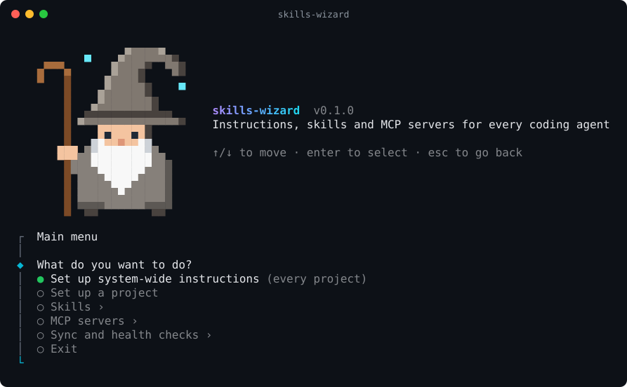
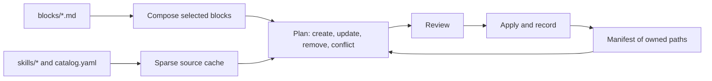

<div align="center">

# 🧙 skills-wizard

**One source of truth for your coding agents' instructions, skills and MCP servers.**

[](https://github.com/feRpicoral/skills-wizard/actions/workflows/ci.yml)
[](https://github.com/feRpicoral/skills-wizard/actions/workflows/catalog-health.yml)
[](LICENSE)
[](.nvmrc)
[](tsconfig.json)
[](https://www.conventionalcommits.org)



</div>

The source of truth for my coding-agent instructions, skills, and MCP servers. A CLI composes `AGENTS.md` from reusable blocks, installs first-party and curated third-party skills, and configures curated MCP servers for the tools you pick, either system-wide or per project.

Supported tools: Claude Code, Codex, Gemini CLI, Antigravity (IDE and `agy`) and Copilot.

## Why skills-wizard

Every coding agent reads its instructions, skills and MCP servers from a different place, in a different format. Keeping them in sync by hand drifts fast. The `skills-wizard` CLI keeps one library in git and renders it into each tool's native layout, only touching the files it owns.

## Features

- 🧱 **Composable instructions:** build `AGENTS.md` from ordered, validated blocks, with variables filled in from your environment.
- 🧰 **Skills, first- and third-party:** install skills from `skills/` and a curated `catalog.yaml`, search `skills.sh` and the awesome skills index, and review risk flags before anything is added.
- 🔌 **Curated MCP servers:** version-pinned servers rendered into each client's JSON or TOML config, with secrets kept as environment references and tool allow/deny lists.
- 🗂️ **Stack presets:** detect Next.js, NestJS, Nx, Expo, Vite, Python and Node projects and preselect matching blocks, skills and MCP servers.
- 📋 **Plan before apply:** every write is shown as a plan first; managed regions and a manifest mean files you edited yourself are never overwritten.
- 🩺 **Health checks and updates:** `doctor` reports drift and conflicts, and `update` summarizes upstream skill changes before refreshing installs.
- 📊 **Skill evals:** benchmark skills with and without the skill, and measure trigger precision and recall across agent CLIs.
- 🧙 **Interactive menu:** run it with no arguments for a navigable menu that returns after every action.

## Quick start

Once the package is published to npm, run it without cloning (Node 24 or newer):

```bash
npx skills-wizard
```

Installing it (`npm install -g skills-wizard`) provides the `skills-wizard` command. To work from a clone:

```bash
git clone git@github.com:feRpicoral/skills-wizard.git
cd skills-wizard
nvm use && corepack enable && yarn install
yarn skills-wizard
```

With no command, the CLI opens an interactive menu. The system-wide flow can link a `skills-wizard` command into `~/.local/bin`, so it runs from any directory once `~/.local/bin` is on your `PATH`.

Without a terminal, commands print the plan and only write when you pass `--yes`.

## Interactive menu

`skills-wizard` with no command (in a terminal) shows the wizard banner and the main menu. Use ↑/↓ to move and enter to select.

- **Stays open:** after an action finishes, fails or is cancelled, you return to the menu you started it from, so you can list MCP servers, run `doctor` and then set up a project in one session.
- **Back and Exit:** every submenu (Skills, MCP servers, Sync and health checks) ends with **← Back** and **Exit**. Esc goes back one level, cancels a running prompt, and on the main menu exits.
- **Colors:** the banner uses 24-bit color when available, the 256-color palette otherwise, and plain ASCII art on 16-color or monochrome terminals. `NO_COLOR` and `FORCE_COLOR` are honored, and narrow terminals get the title below the art.

The screenshot above is generated from the real banner with `yarn readme:screenshot`.

## Commands

| Command                                             | What it does                                                                                                                           |
| --------------------------------------------------- | -------------------------------------------------------------------------------------------------------------------------------------- |
| `skills-wizard init --global`                       | Install instructions and skills for the selected tools                                                                                 |
| `skills-wizard init --project <dir>`                | Write a project `AGENTS.md`, project skills, `CLAUDE.md` and Gemini CLI settings                                                       |
| `skills-wizard sync [--project <dir>]`              | Re-render everything recorded in the manifest                                                                                          |
| `skills-wizard update`                              | Fetch upstream skill updates, show changed files and risk flags, and refresh recorded installs                                         |
| `skills-wizard add [query\|url]`                    | Search `skills.sh` and the awesome skills index or inspect a GitHub repository/URL, scan risk flags, and add a skill to `catalog.yaml` |
| `skills-wizard adopt [skill...]`                    | Back up and take over existing unmanaged skills (after `init --global`)                                                                |
| `skills-wizard doctor [--project <dir>]`            | Report drift, conflicts, skill name clashes and tool-specific problems                                                                 |
| `skills-wizard skill validate [path...]`            | Validate skill directories against the Agent Skills spec (`--catalog` checks `catalog.yaml`)                                           |
| `skills-wizard skill new <name>`                    | Scaffold a first-party skill in `skills/<name>` (`--template`, `--with-evals`)                                                         |
| `skills-wizard skill eval <name>`                   | Benchmark a skill (`with_skill` vs `without_skill` or `--baseline <ref>`, and optional `--compare <ref>` or `<skill-a>,<skill-b>`)     |
| `skills-wizard skill triggers <name>`               | Measure trigger precision, recall and false positive rate on `evals/trigger_queries.json`                                              |
| `skills-wizard skill report <name> [iteration-dir]` | Regenerate `report.md` for the latest iteration, a named one (`iteration-<N>`) or a run directory                                      |
| `skills-wizard mcp [list]`                          | List curated MCP servers from `mcp/servers.yaml` and their install status                                                              |
| `skills-wizard mcp add <name...>`                   | Install curated MCP servers into the selected scope                                                                                    |
| `skills-wizard mcp remove <name...>`                | Remove installed MCP servers from the selected scope                                                                                   |
| `skills-wizard mcp search <query>`                  | Search the MCP registry (`--official`, `--limit`, `--add`) and optionally append to `mcp/servers.yaml`                                 |

Common flags: `--tools`, `--blocks`, `--skills`, `--mcp`, `--skill-mode copy|link`, `--preset <id|none>`, `--style lean|self-contained|strict`, `--var name=value`, `--yes`, `--dry-run` and `--local` (keep project files out of git). `skills-wizard --help` lists all of them.

## Stack presets and project onboarding

`skills-wizard init --project <dir>` inspects the project directory (`package.json`, `nx.json`, `pyproject.toml`, `.nvmrc`, `prisma/schema.prisma`, `supabase/config.toml`, `components.json` and workspace packages under `apps/*`, `packages/*`, `libs/*`) to auto-detect a stack preset and generate a project-specific seed preamble (`# <name>`, description, `## Commands`, `## Workspaces`) above `<!-- BEGIN:skills-wizard -->`:

| Preset ID        | Stack blocks (`stack/*`)                                                                    | Preselected skills                                                                                                                                                                                                                                                   |
| ---------------- | ------------------------------------------------------------------------------------------- | -------------------------------------------------------------------------------------------------------------------------------------------------------------------------------------------------------------------------------------------------------------------- |
| `nextjs-app`     | `typescript`, `node-yarn`, `lint-format`, `nextjs`, `tailwind-shadcn`                       | `eslint-configuration`, `prettier-configuration`, `vercel-react-best-practices`, `vercel-composition-patterns`, `web-design-guidelines`                                                                                                                              |
| `nestjs-api`     | `typescript`, `node-yarn`, `lint-format`, `nestjs`                                          | `eslint-configuration`, `prettier-configuration`, `nestjs-module`                                                                                                                                                                                                    |
| `nx-monorepo`    | `typescript`, `node-yarn`, `lint-format`, `nx` (+ detected workspace app/lib stack blocks)  | `eslint-configuration`, `prettier-configuration` (+ detected workspace skills)                                                                                                                                                                                       |
| `expo-app`       | `typescript`, `node-yarn`, `lint-format`, `expo-react-native`, `tanstack-query`             | `eslint-configuration`, `prettier-configuration`, `eas-workflows`, `eas-update`, `expo-dev-client`, `expo-upgrade`, `expo-module`, `react-native-best-practices`, `react-navigation`, `react-native-testing`, `upgrading-react-native`, `vercel-react-native-skills` |
| `vite-spa`       | `typescript`, `node-yarn`, `lint-format`, `react-vite`, `tailwind-shadcn`, `tanstack-query` | `eslint-configuration`, `prettier-configuration`, `vercel-react-best-practices`, `web-design-guidelines`                                                                                                                                                             |
| `python-service` | `python-uv`                                                                                 | (none by default)                                                                                                                                                                                                                                                    |
| `node-tool`      | `typescript`, `node-yarn`, `lint-format`                                                    | `eslint-configuration`, `prettier-configuration`                                                                                                                                                                                                                     |

Additive detections automatically include `stack/prisma` (`prisma-cli`, `prisma-client-api`, `prisma-orm-setup`, `prisma-upgrade-v7`), `stack/supabase-prisma` (`supabase-prisma`, `supabase`, `supabase-postgres-best-practices`), `stack/tanstack-query` (`tanstack-query-expert`), `stack/tailwind-shadcn` (`tailwind-patterns`), `stack/llm-apps` (`ai-sdk`, `claude-api`) and `playwright-cli` when those packages or config files are present, and auto-select project-scoped MCP servers (`nx`, `supabase`, `sentry`) when detected in the project. Use `--style lean` (default when a system-wide install exists) to include only `stack/*` blocks in project `AGENTS.md` alongside the global `AGENTS.md`, or `--style self-contained` (default when no system-wide install exists) to include project-default core, engineering and git blocks alongside `stack/*` blocks in a standalone file.

## How it works



- The CLI only rewrites text between `<!-- BEGIN:skills-wizard -->` and `<!-- END:skills-wizard -->`. Everything outside the markers stays as it is, including regions that other tools write.
- System-wide skills are copied once into `~/.agents/skills/<name>` (or linked from `skills/<name>` in `link` mode for first-party skills) and symlinked into each selected tool's skill directory when needed. Project skills are copied into `.agents/skills/<name>` and linked relatively from `.claude/skills/<name>` for Claude Code.
- The manifest (`~/.agents/skills-wizard/manifest.json`, or `.agents/skills-wizard.json` in a project) lists every path the CLI owns, along with skill provenance and content hashes. Locally edited skill copies are flagged as conflicts rather than overwritten, and unmanaged skill folders can be taken over with `skills-wizard adopt` after a backup. `adopt` needs an existing system-wide install (`skills-wizard init --global`), refuses folders whose name differs from the skill's declared `name`, and checks upstreams it reads from `~/.agents/.skill-lock.json` before changing anything, then appends them to the end of `catalog.yaml` without reformatting it, just before applying, and takes back out the entries for skills a failed apply did not record.
- `skills-wizard update` checks upstream repositories, summarizes changed files and risky patterns (such as `curl | sh`, `npx --yes`, `@latest`, new executables or hook changes), and refreshes the system-wide install and every recorded project. A project whose manifest is unreadable or records skills outside its skills folders, and an install whose blocks gained a variable with no value, are skipped with a warning, as is a corrupt projects registry; recorded projects whose manifest is gone are forgotten only once the update is applied, and refreshed source checkouts move back if nothing is applied.

## Repository layout

| Path                                                     | What lives there                                                                  |
| -------------------------------------------------------- | --------------------------------------------------------------------------------- |
| `blocks/`                                                | Instruction fragments; `blocks/index.yaml` sets the order and group labels        |
| `presets/`                                               | Stack presets mapping project archetypes to `stack/*` blocks and skills           |
| `skills/`                                                | First-party skills, validated against the Agent Skills spec                       |
| `catalog.yaml`                                           | Curated third-party skills by upstream repository and path                        |
| `mcp/servers.yaml`                                       | Curated MCP servers with scope defaults, detection keys, secrets and tool filters |
| `src/commands/`                                          | CLI commands and the interactive menu                                             |
| `src/prompts/`                                           | Interactive prompts and the launch banner                                         |
| `src/blocks/`, `src/skills/`, `src/mcp/`, `src/install/` | Composition, skill sources, MCP rendering, planning and applying                  |
| `docs/`                                                  | Architecture and per-tool reference                                               |

[docs/architecture.md](docs/architecture.md) covers the details, and [docs/tools.md](docs/tools.md) lists where each tool reads its files.

## Adding or editing a block

1. Create `blocks/<group>/<id>.md` with frontmatter: `title`, `summary`, `group`, `scopes`, `defaults` and, if needed, `variables` and `requires` (blocks it depends on or whose sections it refers to, listed earlier in the order).
2. Add its id to `blocks/index.yaml` where it should appear in the composed file.
3. Run `yarn test`.
4. Run `skills-wizard init` and select the new block. `sync` only re-renders the blocks an install already recorded, so it picks up edits to existing blocks but never adds new ones. When an edit adds a variable to a recorded block, `sync` looks the value up the way `init` does and otherwise asks you to set it with `skills-wizard init --var name=value`.

## Adding and evaluating a skill

- **First-party skill:** scaffold `skills/<name>` with `yarn skills-wizard skill new <name> --with-evals` (or use the `skill-author` skill), author `SKILL.md` with spec-compliant frontmatter (`name` matching `<name>` and `description` stating when to use the skill), and run `yarn skills-wizard skill validate skills/<name>`.
- **Benchmarking and triggers:** define test cases in `skills/<name>/evals/evals.json` and trigger queries in `skills/<name>/evals/trigger_queries.json`, then run `yarn skills-wizard skill eval <name>` (including `--compare <ref>` for a historical snapshot or `--compare <skill-a>,<skill-b>` to benchmark competing skills side by side) and `yarn skills-wizard skill triggers <name>` (or use the `skill-evaluator` skill). Reports and `benchmark.json` artifacts are written to `~/.agents/skills-wizard/evals/<name>/`. Eval runs start the real agent CLIs with your home directory, settings and credentials, and they are not confined: `--sandbox` reaches only runners that support it (the CLI warns otherwise), so review eval prompts and fixtures before running them, or check that a suite loads and produces reports with `--runner fake` (its results are synthetic). [docs/tools.md](docs/tools.md#skill-evaluation) lists the runner settings.
- **Third-party skill:** run `yarn skills-wizard add [query|owner/repo[@skill]|url]` (`--source skills-sh|awesome|all`, `--category <category>`, `--ref <ref>`, `--include-offensive`, `--install`) to search `skills.sh` and `sickn33/agentic-awesome-skills` (`skills_index.json`), locate the skill path in the upstream repository, validate `SKILL.md` and scan risk flags before appending to `catalog.yaml`, or add an entry directly to `catalog.yaml` (`name`, `repo`, `path`, `category`, `scopes`, optional `ref` (a branch, tag or full commit SHA), `defaults`, `setup`, `note`) and run `yarn skills-wizard skill validate --catalog`.

## Curated MCP servers

`mcp/servers.yaml` defines curated MCP servers with explicit version pins and remote endpoints (remote `https://mcp.context7.com/mcp`, `fetcher-mcp@0.2.1`, `mcp-server-reddit@0.5.2`, `nx-mcp@0.3.2`, `@supabase/mcp-server-supabase@0.5.5`, and remote `https://mcp.sentry.dev/mcp`):

- **Global defaults:** `context7`, `fetcher`, and `reddit`.
- **Project auto-detected:** `nx` (when `nx.json` or `nx` is present), `supabase` (read-only by default, when `supabase/config.toml` or `@supabase/supabase-js` is present), and `sentry` (when `@sentry/*` or `sentry-sdk` is present).
- **Secrets and tool filtering:** Secret tokens are referenced via `{ secret: ENV_VAR_NAME, optional?: boolean }` in `mcp/servers.yaml` and rendered into each tool's native environment interpolation syntax, so secret values are never written to disk or manifests. Tool allow/deny lists (`tools.allow` / `tools.deny`) map to each client's native filtering fields (`enabledTools`/`disabledTools`, `includeTools`/`excludeTools`, `tools`, and Claude Code `permissions.deny`).
- **Registry discovery:** Run `skills-wizard mcp search <query> [--official] [--limit <n>] [--add]` to search the GitHub MCP Registry (`https://api.mcp.github.com/v0.1/servers`) or the official MCP Registry (`https://registry.modelcontextprotocol.io/v0.1/servers`) and append a server definition to `mcp/servers.yaml`.

## License

[GPL-3.0-only](LICENSE)
