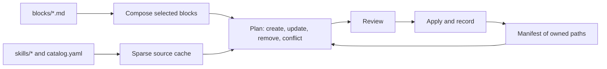

# agents-config

The source of truth for my coding-agent instructions and skills. A CLI composes `AGENTS.md` from reusable blocks, installs first-party and curated third-party skills, and links them into the tools you pick, either system-wide or per project.

Supported tools: Claude Code, Codex, Gemini CLI, Antigravity (IDE and `agy`) and Copilot.

## Quick start

```bash
git clone git@github.com:feRpicoral/agents-config.git
cd agents-config
nvm use && corepack enable && yarn install
yarn agents-config
```

With no command, the CLI opens an interactive menu. The system-wide flow can link an `agents-config` command into `~/.local/bin`, so it runs from any directory once `~/.local/bin` is on your `PATH`.

Without a terminal, commands print the plan and only write when you pass `--yes`.

## Commands

| Command                                             | What it does                                                                                                                           |
| --------------------------------------------------- | -------------------------------------------------------------------------------------------------------------------------------------- |
| `agents-config init --global`                       | Install instructions and skills for the selected tools                                                                                 |
| `agents-config init --project <dir>`                | Write a project `AGENTS.md`, project skills, `CLAUDE.md` and Gemini CLI settings                                                       |
| `agents-config sync [--project <dir>]`              | Re-render everything recorded in the manifest                                                                                          |
| `agents-config update`                              | Fetch upstream skill updates, show changed files and risk flags, and refresh recorded installs                                         |
| `agents-config add [query\|url]`                    | Search `skills.sh` and the awesome skills index or inspect a GitHub repository/URL, scan risk flags, and add a skill to `catalog.yaml` |
| `agents-config adopt [skill...]`                    | Back up and take over existing unmanaged skills (after `init --global`)                                                                |
| `agents-config doctor [--project <dir>]`            | Report drift, conflicts, skill name clashes and tool-specific problems                                                                 |
| `agents-config skill validate [path...]`            | Validate skill directories against the Agent Skills spec (`--catalog` checks `catalog.yaml`)                                           |
| `agents-config skill new <name>`                    | Scaffold a first-party skill in `skills/<name>` (`--template`, `--with-evals`)                                                         |
| `agents-config skill eval <name>`                   | Benchmark a skill (`with_skill` vs `without_skill` or `--baseline <ref>`, and optional `--compare <ref>` or `<skill-a>,<skill-b>`)     |
| `agents-config skill triggers <name>`               | Measure trigger precision, recall and false positive rate on `evals/trigger_queries.json`                                              |
| `agents-config skill report <name> [iteration-dir]` | Regenerate `report.md` for the latest iteration, a named one (`iteration-<N>`) or a run directory                                      |

Common flags: `--tools`, `--blocks`, `--skills`, `--skill-mode copy|link`, `--preset <id|none>`, `--style lean|self-contained|strict`, `--var name=value`, `--yes`, `--dry-run` and `--local` (keep project files out of git). `agents-config --help` lists all of them.

## Stack presets and project onboarding

`agents-config init --project <dir>` inspects the project directory (`package.json`, `nx.json`, `pyproject.toml`, `.nvmrc`, `prisma/schema.prisma`, `supabase/config.toml`, `components.json` and workspace packages under `apps/*`, `packages/*`, `libs/*`) to auto-detect a stack preset and generate a project-specific seed preamble (`# <name>`, description, `## Commands`, `## Workspaces`) above `<!-- BEGIN:agents-config -->`:

| Preset ID        | Stack blocks (`stack/*`)                                                                    | Preselected skills                                                                                                                                                                                                                                                   |
| ---------------- | ------------------------------------------------------------------------------------------- | -------------------------------------------------------------------------------------------------------------------------------------------------------------------------------------------------------------------------------------------------------------------- |
| `nextjs-app`     | `typescript`, `node-yarn`, `lint-format`, `nextjs`, `tailwind-shadcn`                       | `eslint-configuration`, `prettier-configuration`, `vercel-react-best-practices`, `vercel-composition-patterns`, `web-design-guidelines`                                                                                                                              |
| `nestjs-api`     | `typescript`, `node-yarn`, `lint-format`, `nestjs`                                          | `eslint-configuration`, `prettier-configuration`, `nestjs-module`                                                                                                                                                                                                    |
| `nx-monorepo`    | `typescript`, `node-yarn`, `lint-format`, `nx` (+ detected workspace app/lib stack blocks)  | `eslint-configuration`, `prettier-configuration` (+ detected workspace skills)                                                                                                                                                                                       |
| `expo-app`       | `typescript`, `node-yarn`, `lint-format`, `expo-react-native`, `tanstack-query`             | `eslint-configuration`, `prettier-configuration`, `eas-workflows`, `eas-update`, `expo-dev-client`, `expo-upgrade`, `expo-module`, `react-native-best-practices`, `react-navigation`, `react-native-testing`, `upgrading-react-native`, `vercel-react-native-skills` |
| `vite-spa`       | `typescript`, `node-yarn`, `lint-format`, `react-vite`, `tailwind-shadcn`, `tanstack-query` | `eslint-configuration`, `prettier-configuration`, `vercel-react-best-practices`, `web-design-guidelines`                                                                                                                                                             |
| `python-service` | `python-uv`                                                                                 | (none by default)                                                                                                                                                                                                                                                    |
| `node-tool`      | `typescript`, `node-yarn`, `lint-format`                                                    | `eslint-configuration`, `prettier-configuration`                                                                                                                                                                                                                     |

Additive detections automatically include `stack/prisma` (`prisma-cli`, `prisma-client-api`, `prisma-orm-setup`, `prisma-upgrade-v7`), `stack/supabase-prisma` (`supabase-prisma`, `supabase`, `supabase-postgres-best-practices`), `stack/tanstack-query` (`tanstack-query-expert`), `stack/tailwind-shadcn` (`tailwind-patterns`), `stack/llm-apps` (`ai-sdk`, `claude-api`) and `playwright-cli` when those packages or config files are present. Use `--style lean` (default when a system-wide install exists) to include only `stack/*` blocks in project `AGENTS.md` alongside the global `AGENTS.md`, or `--style self-contained` (default when no system-wide install exists) to include project-default core, engineering and git blocks alongside `stack/*` blocks in a standalone file.

## How it works



- The CLI only rewrites text between `<!-- BEGIN:agents-config -->` and `<!-- END:agents-config -->`. Everything outside the markers stays as it is, including regions that other tools write.
- System-wide skills are copied once into `~/.agents/skills/<name>` (or linked from `skills/<name>` in `link` mode for first-party skills) and symlinked into each selected tool's skill directory when needed. Project skills are copied into `.agents/skills/<name>` and linked relatively from `.claude/skills/<name>` for Claude Code.
- The manifest (`~/.agents/agents-config/manifest.json`, or `.agents/agents-config.json` in a project) lists every path the CLI owns, along with skill provenance and content hashes. Locally edited skill copies are flagged as conflicts rather than overwritten, and unmanaged skill folders can be taken over with `agents-config adopt` after a backup. `adopt` needs an existing system-wide install (`agents-config init --global`), refuses folders whose name differs from the skill's declared `name`, and checks upstreams it reads from `~/.agents/.skill-lock.json` before changing anything, then appends them to the end of `catalog.yaml` without reformatting it, just before applying, and takes back out the entries for skills a failed apply did not record.
- `agents-config update` checks upstream repositories, summarizes changed files and risky patterns (such as `curl | sh`, `npx --yes`, `@latest`, new executables or hook changes), and refreshes the system-wide install and every recorded project. A project whose manifest is unreadable or records skills outside its skills folders, and an install whose blocks gained a variable with no value, are skipped with a warning, as is a corrupt projects registry; recorded projects whose manifest is gone are forgotten only once the update is applied, and refreshed source checkouts move back if nothing is applied.

[docs/architecture.md](docs/architecture.md) covers the details, and [docs/tools.md](docs/tools.md) lists where each tool reads its files.

## Adding or editing a block

1. Create `blocks/<group>/<id>.md` with frontmatter: `title`, `summary`, `group`, `scopes`, `defaults` and, if needed, `variables` and `requires` (blocks it depends on or whose sections it refers to, listed earlier in the order).
2. Add its id to `blocks/index.yaml` where it should appear in the composed file.
3. Run `yarn test`.
4. Run `agents-config init` and select the new block. `sync` only re-renders the blocks an install already recorded, so it picks up edits to existing blocks but never adds new ones. When an edit adds a variable to a recorded block, `sync` looks the value up the way `init` does and otherwise asks you to set it with `agents-config init --var name=value`.

## Adding and evaluating a skill

- **First-party skill:** scaffold `skills/<name>` with `yarn agents-config skill new <name> --with-evals` (or use the `skill-author` skill), author `SKILL.md` with spec-compliant frontmatter (`name` matching `<name>` and `description` stating when to use the skill), and run `yarn agents-config skill validate skills/<name>`.
- **Benchmarking and triggers:** define test cases in `skills/<name>/evals/evals.json` and trigger queries in `skills/<name>/evals/trigger_queries.json`, then run `yarn agents-config skill eval <name>` (including `--compare <ref>` for a historical snapshot or `--compare <skill-a>,<skill-b>` to benchmark competing skills side by side) and `yarn agents-config skill triggers <name>` (or use the `skill-evaluator` skill). Reports and `benchmark.json` artifacts are written to `~/.agents/agents-config/evals/<name>/`. Eval runs start the real agent CLIs with your home directory, settings and credentials, and they are not confined: `--sandbox` reaches only runners that support it (the CLI warns otherwise), so review eval prompts and fixtures before running them, or check that a suite loads and produces reports with `--runner fake` (its results are synthetic). [docs/tools.md](docs/tools.md#skill-evaluation) lists the runner settings.
- **Third-party skill:** run `yarn agents-config add [query|owner/repo[@skill]|url]` (`--source skills-sh|awesome|all`, `--category <category>`, `--ref <ref>`, `--include-offensive`, `--install`) to search `skills.sh` and `sickn33/agentic-awesome-skills` (`skills_index.json`), locate the skill path in the upstream repository, validate `SKILL.md` and scan risk flags before appending to `catalog.yaml`, or add an entry directly to `catalog.yaml` (`name`, `repo`, `path`, `category`, `scopes`, optional `ref` (a branch, tag or full commit SHA), `defaults`, `setup`, `note`) and run `yarn agents-config skill validate --catalog`.
