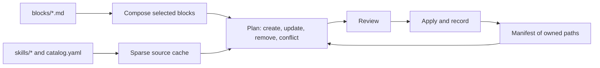

# agents-config

The source of truth for my coding-agent instructions and skills. A CLI composes `AGENTS.md` from reusable blocks, installs first-party and curated third-party skills, and links them into the tools you pick, either system-wide or per project.

Supported tools: Claude Code, Codex, Gemini CLI, Antigravity (IDE and `agy`) and Copilot.

## Quick start

```bash
git clone git@github.com:feRpicoral/agents-config.git
cd agents-config
nvm use && corepack enable && yarn install
yarn agents-config
```

With no command, the CLI opens an interactive menu. The system-wide flow can link an `agents-config` command into `~/.local/bin`, so it runs from any directory once `~/.local/bin` is on your `PATH`.

Without a terminal, commands print the plan and only write when you pass `--yes`.

## Commands

| Command                                  | What it does                                                                                   |
| ---------------------------------------- | ---------------------------------------------------------------------------------------------- |
| `agents-config init --global`            | Install instructions and skills for the selected tools                                         |
| `agents-config init --project <dir>`     | Write a project `AGENTS.md`, project skills, `CLAUDE.md` and Gemini CLI settings               |
| `agents-config sync [--project <dir>]`   | Re-render everything recorded in the manifest                                                  |
| `agents-config update`                   | Fetch upstream skill updates, show changed files and risk flags, and refresh recorded installs |
| `agents-config adopt [skill...]`         | Back up and take over existing unmanaged skills (after `init --global`)                        |
| `agents-config doctor [--project <dir>]` | Report drift, conflicts, skill name clashes and tool-specific problems                         |
| `agents-config skill validate [path...]` | Validate skill directories against the Agent Skills spec (`--catalog` checks `catalog.yaml`)   |

Common flags: `--tools`, `--blocks`, `--skills`, `--skill-mode copy|link`, `--var name=value`, `--yes`, `--dry-run` and `--local` (keep project files out of git). `agents-config --help` lists all of them.

## How it works



- The CLI only rewrites text between `<!-- BEGIN:agents-config -->` and `<!-- END:agents-config -->`. Everything outside the markers stays as it is, including regions that other tools write.
- System-wide skills are copied once into `~/.agents/skills/<name>` (or linked from `skills/<name>` in `link` mode for first-party skills) and symlinked into each selected tool's skill directory when needed. Project skills are copied into `.agents/skills/<name>` and linked relatively from `.claude/skills/<name>` for Claude Code.
- The manifest (`~/.agents/agents-config/manifest.json`, or `.agents/agents-config.json` in a project) lists every path the CLI owns, along with skill provenance and content hashes. Locally edited skill copies are flagged as conflicts rather than overwritten, and unmanaged skill folders can be taken over with `agents-config adopt` after a backup. `adopt` needs an existing system-wide install (`agents-config init --global`), refuses folders whose name differs from the skill's declared `name`, and checks upstreams it reads from `~/.agents/.skill-lock.json` before changing anything, then appends them to the end of `catalog.yaml` without reformatting it.
- `agents-config update` checks upstream repositories, summarizes changed files and risky patterns (such as `curl | sh`, `npx --yes`, `@latest`, new executables or hook changes), and refreshes the system-wide install and every recorded project. A project with an unreadable manifest is skipped with a warning, recorded projects whose manifest is gone are forgotten only once the update is applied, and refreshed source checkouts move back if nothing is applied.

[docs/architecture.md](docs/architecture.md) covers the details, and [docs/tools.md](docs/tools.md) lists where each tool reads its files.

## Adding or editing a block

1. Create `blocks/<group>/<id>.md` with frontmatter: `title`, `summary`, `group`, `scopes`, `defaults` and, if needed, `variables` and `requires` (blocks it depends on, listed earlier in the order).
2. Add its id to `blocks/index.yaml` where it should appear in the composed file.
3. Run `yarn test`.
4. Run `agents-config init` and select the new block. `sync` only re-renders the blocks an install already recorded, so it picks up edits to existing blocks but never adds new ones.

## Adding a skill

- **First-party skill:** create `skills/<name>/SKILL.md` with spec-compliant frontmatter (`name` matching `<name>` and `description` stating when to use the skill) and run `yarn agents-config skill validate skills/<name>`.
- **Third-party skill:** add an entry to `catalog.yaml` (`name`, `repo`, `path`, `category`, `scopes`, optional `ref` (a branch, tag or full commit SHA), `defaults`, `setup`, `note`) and run `yarn agents-config skill validate --catalog`.
