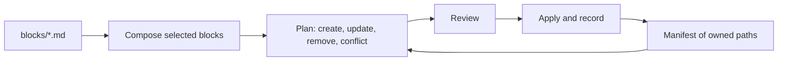

# agents-config

The source of truth for my coding-agent instructions. A CLI composes `AGENTS.md` from reusable blocks and installs it into the tools you pick, either system-wide or per project.

Supported tools: Claude Code, Codex, Gemini CLI, Antigravity (IDE and `agy`) and Copilot.

## Quick start

```bash
git clone git@github.com:feRpicoral/agents-config.git
cd agents-config
nvm use && corepack enable && yarn install
yarn agents-config
```

With no command, the CLI opens an interactive menu. The system-wide flow can link an `agents-config` command into `~/.local/bin`, so it runs from any directory.

## Commands

| Command                                  | What it does                                                                          |
| ---------------------------------------- | ------------------------------------------------------------------------------------- |
| `agents-config init --global`            | Install instructions for the selected tools                                           |
| `agents-config init --project <dir>`     | Write a project `AGENTS.md`, plus `CLAUDE.md` and Gemini CLI settings for those tools |
| `agents-config sync [--project <dir>]`   | Re-render everything recorded in the manifest                                         |
| `agents-config doctor [--project <dir>]` | Report drift, conflicts and tool-specific problems                                    |

Common flags: `--tools`, `--blocks`, `--var name=value`, `--yes`, `--dry-run` and `--local` (keep project files out of git). `agents-config --help` lists all of them.

## How it works



- The CLI only rewrites text between `<!-- BEGIN:agents-config -->` and `<!-- END:agents-config -->`. Everything outside the markers stays as it is, including regions that other tools write.
- The manifest (`~/.agents/agents-config/manifest.json`, or `.agents/agents-config.json` in a project) lists every path the CLI owns. Deselecting a tool removes only what the CLI added for it.
- A project `CLAUDE.md` gets a single `@AGENTS.md` import line.

[docs/architecture.md](docs/architecture.md) covers the details, and [docs/tools.md](docs/tools.md) lists where each tool reads its files.

## Adding or editing a block

1. Create `blocks/<group>/<id>.md` with frontmatter: `title`, `summary`, `group`, `scopes`, `defaults` and, if needed, `variables`.
2. Add its id to `blocks/index.yaml` where it should appear in the composed file.
3. Run `yarn test`, then `agents-config sync` to update installed copies.
