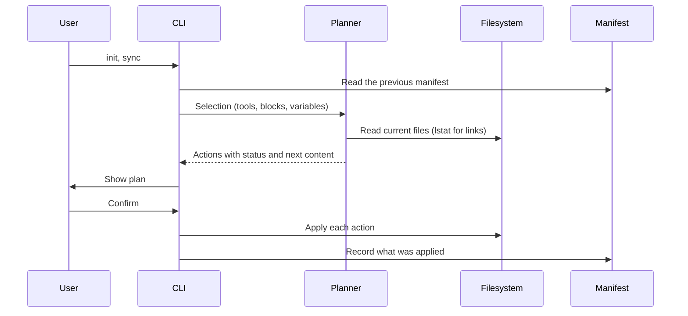

# Architecture

## Flow

Every command that writes builds a plan first. Interactive runs show the plan and ask before applying. Without a terminal, the CLI prints the plan and applies it only with `--yes`. `--dry-run` prints it and exits.

## Blocks

`blocks/index.yaml` lists every block in composition order, together with the group labels and the header for the system-wide file. The loader rejects:

- files missing from the order
- unknown groups, or a group that does not match the block's directory
- defaults outside a block's scopes
- placeholders that are not declared as variables, and declared variables that are never used
- `requires` entries that name an unknown block, a block later in the order, or a block missing one of the scopes

Selecting a block also selects the blocks it requires. Blocks recorded in a manifest that are no longer in the library, or no longer available for the manifest's scope, are dropped with a warning, and `doctor` reports them. When a recorded block gains a variable, `sync` looks up its value the way `init` does (asking for it in a terminal) and records it. If no value is found, `sync` stops with a usage error naming the `init --var` command. `doctor` runs the same lookup: it warns with the value `sync` will record, or reports the missing variable as an error and still checks every file for conflicts.

The system-wide file is the global header plus the selected blocks joined by blank lines. A project file gets the selected blocks inside a managed region, below a `# <project name>` heading that is written once.

## Plans and actions

Each target becomes one action:

| Status      | Meaning                                                                     |
| ----------- | --------------------------------------------------------------------------- |
| `create`    | The file or link does not exist yet                                         |
| `update`    | The managed content differs from what is on disk                            |
| `unchanged` | Nothing to do, including when the CLI stops tracking a path it never edited |
| `remove`    | Content the CLI added is removed because it is no longer selected           |
| `conflict`  | The file cannot be changed safely, so it is left untouched                  |

Conflicts come from malformed markers, JSON files with comments or invalid syntax, unmanaged files at a path the CLI wants to own (for example `~/.local/bin/agents-config`), paths that are directories, special files or unreadable, links to missing locations, and project files whose real location is outside the project.

Targets are planned in order against the content that earlier actions in the same plan leave behind, keyed by the real location with every link resolved. When two targets reach one file through different paths, such as `~/.claude/CLAUDE.md` and `~/.codex/AGENTS.md` linked to the same dotfile, each write builds on the ones before it, so the file ends up with one coherent result.

## Writers

- **Managed region.** Text between `<!-- BEGIN:agents-config -->` and `<!-- END:agents-config -->`. A file without markers gets the region appended after its content. Duplicate or unmatched markers are a conflict. Lines outside the region keep their own line endings, and new lines use the ending most of the file uses.
- **Import line.** A single line such as `@AGENTS.md`, prepended to an existing `CLAUDE.md`. A `CLAUDE.md` and an `AGENTS.md` that are one file through a link, whichever way it points, need no import line and are left alone, even before `AGENTS.md` exists. An import line the CLI added before the two became one file is removed, so the file never imports itself.
- **JSON array values.** Adds values to a key such as `context.fileName` and removes only the values the CLI added. A string value is converted to a list and restored on removal. The change is spliced into the text at the key's position, so every other byte of the file stays as written, and removing it deletes exactly what was inserted. Removal prunes only the parent objects the CLI created, once they are empty. Manifest entries written before parents were recorded count every parent as created when the CLI created the file, and only the key itself otherwise. Files with comments are refused. The positions come from the parse tree of `jsonc-parser`, because `JSON.parse` only returns values: rewriting a user's settings file from them would reformat numbers, escapes and layout the CLI does not own.
- **Exclude region.** `# BEGIN:agents-config <dir>` markers in the repository's `info/exclude`, one region per project, with patterns relative to the repository root. Each pattern starts with `/` and escapes gitignore metacharacters (`[`, `]`, `*`, `?`, `\` and trailing spaces), so it matches only the literal path. When a project kept local is no longer in a git repository, the option is dropped with a notice, the recorded exclude entries are left untouched, and `doctor` warns that `sync` will drop it.
- **Symlink.** Replaced only when the manifest owns it and it still points where the CLI left it. A link someone retargeted is left alone.

A target that is itself a symlink, such as a `CLAUDE.md` linked from a dotfiles repository, is written through: the CLI edits the file the link points to and keeps the link. In a project, this only happens when the real location, with every link resolved, is inside the project. A committed link or linked directory that leads elsewhere is a conflict, so a repository cannot point the CLI at files such as `~/.zshrc`. The git exclude file is the one exception, because git itself reports where it is.

Writes are atomic: content goes to a temporary file, which is then renamed over the target. The file keeps its permissions and a leading UTF-8 byte order mark.

## Manifests

| Scope       | File                                    | Paths                            |
| ----------- | --------------------------------------- | -------------------------------- |
| System-wide | `~/.agents/agents-config/manifest.json` | Absolute                         |
| Project     | `<project>/.agents/agents-config.json`  | Relative, so it can be committed |

A manifest stores the selection (tools, blocks, variables, options) and one entry per owned path. After an apply, the manifest records every action that actually ran, so if an action fails, the files already written stay tracked. The manifest must be a regular file: a symlinked manifest, or one inside a link to a missing location, stops the run before anything is written. If the manifest cannot be written after other changes were applied, the error lists those changes. A system-wide manifest is rejected when an entry path or link target is relative. A project manifest is rejected when an entry points outside the project or when the manifest itself would be read or written outside it. Git exclude entries recorded for another repository, which happens when a project is moved or copied, are ignored with a warning and never touched.

## Ownership rules

- Only paths recorded in a manifest are ever modified or deleted.
- A file the CLI created is deleted when its managed content is removed and nothing else is left, including the project heading it wrote. A file that existed before keeps its other content. A blank file that existed before gets the project heading too, and is left empty once the region is removed.
- A file shared by several tools, such as `~/.gemini/AGENTS.md`, stays until no selected tool uses it. Sharing is counted by real location, so this also holds for files that tools reach through links.
- Directories the CLI created are left in place.

## Exit codes

| Code | Meaning                                                                                       |
| ---- | --------------------------------------------------------------------------------------------- |
| 0    | Success                                                                                       |
| 1    | Conflicts were skipped, `doctor` found errors, the run was cancelled, or `--yes` was required |
| 2    | Usage error                                                                                   |
