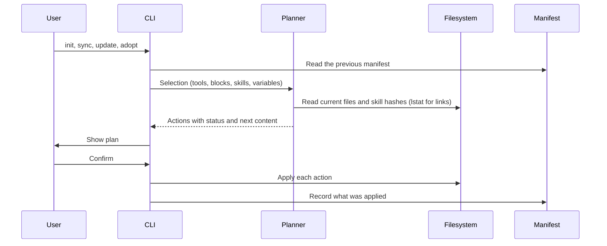

# Architecture

## Flow

Every command that writes builds a plan first. Interactive runs show the plan and ask before applying. Without a terminal, the CLI prints the plan and applies it only with `--yes`. `--dry-run` prints it and exits.

## Blocks

`blocks/index.yaml` lists every block in composition order, together with the group labels and the header for the system-wide file. The loader rejects:

- files missing from the order
- unknown groups, or a group that does not match the block's directory
- defaults outside a block's scopes
- placeholders that are not declared as variables, and declared variables that are never used
- `requires` entries that name an unknown block, a block later in the order, or a block missing one of the scopes

Selecting a block also selects the blocks it requires. A block's `skills` lists skills that go with it: unless `--skills` is given, `init` preselects the skills of every selected block that the previous install did not record (every selected block on a first run), next to the preset, detected or recorded skills, and leaves out the skills of recorded blocks that are no longer selected unless a selected block or the preset still suggests them. A test checks that each listed skill exists for the block's scopes. Blocks recorded in a manifest that are no longer in the library, or no longer available for the manifest's scope, are dropped with a warning by `sync`, `update` and `adopt` (including a replacement-skill hint when a block was replaced by a first-party skill such as `github-repo-setup` or `supabase-prisma`), and `doctor` reports them. When a recorded block gains a variable, `sync`, `update` and `adopt` look up its value the way `init` does (asking for it in a terminal) and record it. If no value is found, `sync` and `adopt` stop with a usage error naming the `init --var` command before anything is written, and `update` skips that install with a warning naming the command and refreshes the others. `doctor` runs the same lookup: it warns with the value `sync` will record, or reports the missing variable as an error and still checks every file for conflicts and every skill folder and link for changes.

The system-wide file is the global header plus the selected blocks joined by blank lines. A project file gets the selected blocks inside a managed region, below a project seed preamble (`# <project name>`, optional description, `## Commands` and `## Workspaces`) that is written once when creating the file and preserved outside `<!-- BEGIN:skills-wizard -->` across `sync` and `update`.

## Project stack presets, detection and seed generation (`src/project/`)

`presets/<id>.yaml` defines the seven built-in project stack presets (`nextjs-app`, `nestjs-api`, `nx-monorepo`, `expo-app`, `vite-spa`, `python-service`, `node-tool`), validated with `zod` against the repository's `BlockLibrary` and `SkillLibrary` (`src/project/presets.ts`).

When initializing a project (`skills-wizard init --project <dir>`), `detectProject` (`src/project/detect.ts`) inspects regular files inside the project boundary (`package.json`, `nx.json`, `pnpm-workspace.yaml`, `pyproject.toml`, `.nvmrc`, `prisma/schema.prisma`, `prisma.config.ts`, `supabase/config.toml`, `components.json`, lockfiles and declared workspace packages) to:

1. Select a matching preset (or union workspace sub-app/lib stacks) and additive blocks/skills (`stack/prisma` + `prisma-*`, `supabase-prisma`/`supabase`/`supabase-postgres-best-practices`, `stack/tanstack-query` + `tanstack-query-expert`, `stack/tailwind-shadcn` + `tailwind-patterns`, `stack/llm-apps` + `ai-sdk`/`claude-api`, `playwright-cli`).
2. Resolve the block selection in either `lean` style (default when a system-wide install exists: only `stack/*` blocks, assuming global `AGENTS.md` is installed) or `self-contained`/`strict` style (default when no system-wide install exists: project-default core, engineering and git blocks plus `stack/*` blocks), recording the chosen `preset` (`<id>` or `'none'`) in the project manifest so re-runs preserve it.
3. Synthesize the initial project seed preamble (`src/project/seed.ts`) with `# <name>`, description, `## Commands` and `## Workspaces` (falling back to `# <name>` when no scripts or workspaces exist).
4. Detect project-scoped MCP server keys (`nx`, `supabase`, `sentry`) on `ProjectDetection.detectedMcpServers` so `init --project` preselects matching servers from `mcp/servers.yaml`.

## Curated MCP servers (`src/mcp/`)

`mcp/servers.yaml` defines curated MCP servers (`stdio`, `http`, `sse`) validated with `zod` (`src/mcp/model.ts`). Each server declares `name`, `description`, `scopes` (`global` and/or `project`), `defaults`, optional `detect` key (`nx`, `supabase`, `sentry`), transport settings (`command`/`args`/`cwd`/`env` for `stdio`, or `url`/`headers` for `http`/`sse`), optional `tools` (`allow`/`deny`), and optional `estimatedTools`. Environment variables and HTTP headers use `{ secret: "ENV_VAR_NAME", optional?: true }` for secrets so secret values are never stored in `mcp/servers.yaml`, tool config files, or manifests.

`src/mcp/render.ts` renders the selected servers into each tool's native schema and secret syntax:

- **Antigravity (`antigravity` and `antigravity-cli`, shared target):** `~/.gemini/config/mcp_config.json` (global) and `.agents/mcp_config.json` (project). Remote servers emit both `url` and `serverUrl`. Because Antigravity does not expand `${VAR}` placeholders in `mcp_config.json` and passes `stdio` process environments from its parent process, `stdio` secret env vars are omitted from the `env` block, optional secret headers are omitted, and remote servers with required secret headers are skipped for Antigravity with a plan warning. Tool filters map to `enabledTools` and `disabledTools`.
- **Claude Code (`claude-code`):** `~/.claude.json` (global) and `.mcp.json` (project), plus `permissions.deny` entries (`mcp__<server>__<tool>`) merged into `~/.claude/settings.json` or `.claude/settings.json` when `tools.deny` is set. Secrets render as `${VAR}`.
- **Codex (`codex`):** `[mcp_servers.<name>]` tables inside `# BEGIN:skills-wizard-mcp` / `# END:skills-wizard-mcp` markers in `$CODEX_HOME/config.toml` (global) and `.codex/config.toml` (project). `stdio` secrets use `env_vars = ["VAR"]`; `Authorization` secret headers use `bearer_token_env_var = "VAR"`; other secret headers use `env_http_headers = { Header = "VAR" }`. Tool filters map to `enabled_tools` and `disabled_tools`. SSE servers are skipped with a warning because Codex supports only `stdio` and Streamable HTTP.
- **Gemini CLI (`gemini-cli`):** `mcpServers` in `~/.gemini/settings.json` (global) and `.gemini/settings.json` (project), coexisting with `context.fileName`. Secrets render as `${VAR}` and tool filters map to `includeTools` and `excludeTools`.
- **GitHub Copilot (`copilot`):** `$COPILOT_HOME/mcp-config.json` (global) and `.mcp.json` (project, shared with Claude Code when both are selected). Includes `"tools": ["*"]` (or `tools.allow`) required by Copilot CLI.

`skills-wizard mcp search <query>` (`src/mcp/search.ts`) queries `MCP_REGISTRY_URL` (defaulting to `https://api.mcp.github.com/v0.1/servers`, or `https://registry.modelcontextprotocol.io/v0.1/servers` with `--official`) with `?search=<encodeURIComponent(query)>&version=latest&limit=<n>`, converts `npm` (`npx -y`), `pypi` (`uvx`), and remote (`http`/`streamable-http`/`sse`) entries into validated `McpServerDefinition` objects, and with `--add` appends the selected server to `mcp/servers.yaml`.

`skills-wizard doctor` checks installed MCP servers for unset required secret environment variables (reporting variable names only, never values), notes when Antigravity is used with `stdio` secret env vars (macOS Dock GUI apps may not inherit shell variables), notes project-scoped MCP trust/approval requirements for Claude Code (`.mcp.json`), Codex (`.codex/config.toml`), and Gemini CLI (`.gemini/settings.json`), and reports the estimated tool count when Gemini CLI is selected.

## Skills and the source cache

Skills come from two places:

- `skills/<name>/`: first-party skills in this repository, validated strictly against the Agent Skills specification.
- `catalog.yaml`: curated third-party skills referenced by `repo` (`owner/repo`), `path` (`.` for the repository root or a subdirectory), optional `ref` (branch, tag or 40-char commit SHA), `category`, `scopes`, `defaults`, optional `setup` command and optional `note`.

Upstream repositories are cached under `${XDG_CACHE_HOME:-~/.cache}/skills-wizard/sources/<owner>/<repo>` as depth-1, blob-filtered (`--filter=blob:none`), sparse checkouts limited to the paths listed in `catalog.yaml`. Update checks run `git ls-remote` at most once every 24 hours per repository unless forced by `skills-wizard update`. Git runs with repository-scoped variables removed (everything `git rev-parse --local-env-vars` lists, `GIT_NAMESPACE` and `GIT_CONFIG_KEY_n`/`GIT_CONFIG_VALUE_n`), so a caller's repository or `-c` settings never apply to the cache; settings the cache needs, such as a proxy, belong in the global git config.

When a skill is installed as a copy, the tree walker leaves out `.git`, `.github`, `node_modules`, `.venv`, generated output (`.DS_Store`, `__pycache__`, `*.pyc`, `.pytest_cache`), root `evals/`, and any nested `AGENTS.md`, `CLAUDE.md` or `GEMINI.md`. The manifest records a hash of what is copied: each file's path, whether it is a file or a link, its executable bit and the SHA-256 digest of its content (the target for a link).

Links inside a skill are copied as links only when they are relative and resolve, from the link's own directory and following any other links in the skill along the way, inside the skill folder. An absolute link, one that leaves the folder, such as `/etc/hosts`, `../../shared` or `up/../secret` where `up` links to `..`, or a link loop is a validation error, so the skill is skipped with a problem message, and the copy step refuses it as well.

To decide whether an installed copy is still the one the CLI wrote, the CLI hashes the installed folder the same way but without the copy exclusions: every path counts except generated output, plus `node_modules` and `.venv` when the install record says the skill has a `setup` command. A pristine copy matches the recorded hash, running the skill's scripts or its setup does not change it, and any file someone added, including an `evals/` folder or a nested `AGENTS.md`, makes the copy count as changed outside the CLI.

In system-wide `link` mode, first-party skills are symlinked directly to `skills/<name>` while third-party skills remain copies.

`skills-wizard update` diffs each installed skill copy against the freshly fetched source and scans added or modified files for risky patterns (`curl`/`wget` piped to a shell, downloads run through `bash <(curl …)`, `sh -c "$(wget …)"` or `eval "$(curl …)"`, `npx -y`/`--yes`, unpinned `@latest` packages, `rm -rf` including split flags such as `rm -r -f`, base64 decoded into a shell, new executable files, new or retargeted links, hooks and `allowed-tools` changes, whether written as a string or a list) before asking for confirmation.

`skills-wizard add [query|url]` (`src/skills/discover.ts`, `src/commands/add.ts`) discovers and validates third-party skills before appending them to `catalog.yaml`. It accepts a search query, `owner/repo`, `owner/repo@<skill-name>`, or a GitHub repository/subdirectory URL (`/tree/<ref>/<path>` or `/blob/<ref>/<path>/SKILL.md`). Search queries query `skills.sh` (`GET ${SKILLS_SH_URL:-https://skills.sh}/api/search?q=<query>&limit=20`, sorted by `installs` descending) and the sparse-cloned `skills_index.json` in `sickn33/agentic-awesome-skills` (filtering out `offensive` skills unless `--include-offensive` is passed). When a candidate only names `owner/repo` and a skill name, `locateSkillsInRepo` lists `SKILL.md` blobs in the cached checkout (`git ls-tree -r -z --full-tree HEAD`) across standard skill directories (`skills/<name>`, `.agents/skills/<name>`, `.claude/skills/<name>`, repository root, or nested directories) and matches the YAML frontmatter `name`. `inspectDiscoveredSkill` then expands the sparse checkout to that path, verifies real-path repository containment, runs lenient spec validation (`validateSkill`) and full-tree risk scanning (`scanSkillRisks`), checks `extendCatalog` invariants (no duplicate skill name and shared `ref` per repository), and appends the entry to `catalog.yaml` (rolling it back if `--install` fails before the manifest records the skill).

## Skill evaluation (`src/evals/`)

First-party skills under `skills/<name>/` can include an `evals/` directory (excluded when copying skills into `~/.agents/skills`):

- `evals/evals.json`: validated with `zod` (`src/evals/cases.ts`). Defines test cases with `id`, `prompt`, `expected_output`, optional input `files` under `evals/files/`, and `assertions` (either natural-language strings graded by a blind LLM grader or deterministic scripted checks: `file_exists`, `file_absent`, `regex`, `json_valid`, `command`). Case ids match `^[A-Za-z0-9][A-Za-z0-9._-]*$` and are unique ignoring case, and every case needs at least one assertion.
- `evals/trigger_queries.json`: validated with `zod`. Defines positive (`should_trigger: true`) and near-miss negative (`should_trigger: false`) user prompts. Each query is assigned to `train` or `validation` by its own hash (the first 8 hex digits of the SHA-256 of the query text, modulo 100, below 60 goes to `train`), separately for positives and negatives. The split is approximately 60/40, stays stable as queries are added, and warns when a class has fewer than 2 queries in a split.

A fixture that is itself a skill should be stored as `SKILL.fixture.md`: the harness stages it into the workspace as `SKILL.md`. In system-wide `link` mode, `~/.agents/skills/<name>` links to the whole `skills/<name>` folder, `evals/` included, so a fixture named `SKILL.md` under `evals/files/` is visible to any tool that scans skill folders recursively.

### Evaluation pipeline

`skills-wizard skill eval <name>` runs a four-stage pipeline (`src/evals/engine.ts`):

1. **Workspace preparation (`src/evals/workspace.ts`):** For each `(case, variant, run)` job, creates `<runDir>/workdir` and copies fixture files, stripping leading `evals/files/` and `<case-id>/` segments. Before anything is copied, `validateEvalSuiteFileDestinations` refuses destinations outside the workspace, inside `.git/`, inside the staged skill folder, inside the directories the harness and agent CLIs own (`.agents/`, `.claude/`, `.gemini/`, `.codex/`), or colliding with another fixture of the same case (ignoring case). It then initializes a git repository with those four directories in `.git/info/exclude` and commits the fixture files so `git status` starts clean. Every git command runs with the repository-local `GIT_*` variables removed, `core.hooksPath=/dev/null` and `core.fsmonitor=false`, and the commit uses `--no-verify`, so hooks and fsmonitor commands from the user's git config never run. For `with_skill` and `old_skill` and in trigger workspaces, the skill is staged in the project skills folder the runner's CLI reads, taken from the tool registry: `<workdir>/.claude/skills/<name>` for `claude` and `<workdir>/.agents/skills/<name>` for every other runner. Claude Code runs a personal skill over a project skill with the same name, so a `~/.claude/skills/<name>` folder adds a warning and sets `metadata.with_skill_contaminated` (`PreparedWorkspace.skillShadowed`). It does not change `metadata.baseline_status`, which only `without_skill` workspaces set (`PreparedWorkspace.possiblyContaminated`). For `old_skill` (`--compare <ref>` or `--baseline <ref>`), the snapshot is read with `git ls-tree -z` and `git cat-file blob` from the repository that contains the skill directory, without touching its working tree. Links inside the skill are kept and links that leave it are refused. The ref, the skill at that ref and the runner are all checked before anything is written. After each run the workdir is removed unless `--keep-workdirs` is given. Removal is best effort, so a workdir that cannot be removed does not fail the run.
2. **Runner execution (`src/evals/runners/`):** Auto-detects the default runner on `PATH` using `which` (`agy` -> `claude` -> `codex` -> `gemini`) or uses `--runner`. Spawns the runner in headless stream-JSON mode with the user's real `HOME`, in its own process group, and with only the environment the CLI passes to it (never `process.env` directly). On timeout the whole group gets SIGTERM, then SIGKILL 2 s later. A run settles at most 2 s after the runner exits, even if a descendant keeps its output open, and group members still running are then killed. Ctrl-C or SIGTERM is forwarded to the process groups of every live agent run and `command` assertion before the CLI exits. Eval runs are not confined, so treat them like running the agent yourself. The runner logs the raw `stdout.log` and the full `stderr.log` and extracts the response, duration, token usage and skill trigger signals. A timeout, a non-zero exit, a missing final result event or an error result from the CLI is recorded as a failed run, not a crash: `timing.json` has `timed_out`, `exit_code` and `error` (the reason with the stderr tail, or the CLI's own error message). `timing.json` also records `usage_reported`, which is false when the runner reported no token usage.
3. **Two-phase grading (`src/evals/grade.ts`):** Evaluates deterministic scripted assertions first. `command` assertions run for at most 30 s in their own process group, killed on timeout or when the shell exits, with only the CLI's environment. An error while evaluating one scripted assertion fails only that assertion, with the error as its evidence. Then the grader captures a workspace summary. Its budget of about 60 KB is counted in UTF-8 bytes, with a per-file preview cap. It skips build and vendor directories and binary files, and lists cut files by path and size and unreadable entries by path. The agent response included in the prompt is capped as well, so the whole grader prompt stays under about 100 KB. The grader then invokes the blind LLM grader (`runner.runGrader`) with structured JSON output for natural-language string assertions. It runs from a fresh temporary directory whose path does not name the variant, and that directory is removed after grading. The grader prompt never reveals the variant name. A string assertion without non-empty `evidence` fails, and a passed result whose optional verbatim `quote` is not found in the response or workspace summary is downgraded with "Unverified evidence". Malformed grader output fails closed. When the agent run failed, every assertion fails with "Agent run failed: …" and the grader is not called. When the grader itself fails, only the string assertions fail, with "Grader error: …".
4. **Aggregation and reporting (`src/evals/aggregate.ts`, `src/evals/report.ts`):** Computes the mean, sample standard deviation, min and max across case runs (every run of every case for a variant) for pass rate, duration and token count. Values are stored unrounded and rounded only when rendering. Failed runs count as failures and are counted in `failed_runs`. Token statistics include only runs with `usage_reported` not false, and are `null` ("n/a") when no run reported usage. `metadata.baseline_status` (`clean`, `possibly contaminated` or `skipped`) describes only the `without_skill` runs. `metadata.with_skill_contaminated` is true when `with_skill` or `old_skill` runs may have loaded another copy of the skill, and the report shows it as a separate `with_skill` status. Each assertion gets a `classification` against `without_skill`, or against `old_skill` when the eval ran no baseline: `differentiating`, `non-discriminating`, `regressing`, `failing`, `flaky`, or `no-baseline` when there is no reference. With `--compare`, it also gets an `old_skill_classification` against `old_skill`. `assertion_analysis` lists `pass_only_with_skill` (only when a reference exists), `pass_in_both`, `fail_in_both`, `flaky`, `regressing` (vs `without_skill`) and `regressing_vs_old` (vs `old_skill`). `run_summary.delta` and `old_skill_delta` hold signed strings (pass rate as a fraction such as `"+0.33"`, seconds such as `"+12.40"`, tokens such as `"+1500"` or `"n/a"`). `report.md` and the CLI summary show the pass-rate delta in percentage points, such as `+33.3 pp`. Without `without_skill` runs, the report names `old_skill` as the reference in the analysis and non-discriminating headings and in the per-case classification column. `benchmark.json` and `report.md` are written under `~/.agents/skills-wizard/evals/<name>/iteration-<N>/`. Concurrent evals get separate iteration directories. On a fatal error the eval stops scheduling jobs and writes no benchmark, and `skill report` and the latest-iteration lookup skip iterations without `benchmark.json`.

`benchmark.json` and `triggers.json` carry `schema_version: 1` and are validated with `zod` when they are loaded again (`loadBenchmarkFromIteration`, `loadTriggerSummary`). An unknown version or a malformed file is an `EvalError`. In trigger summaries, a run that failed is left out of its query's trigger rate. A query whose runs all failed has a `null` trigger rate, is counted in `errored_queries` and is left out of the other counts. Precision, recall and every other ratio with a zero denominator are `null`, rendered as "n/a". The console summary of `skill triggers` notes how many queries were excluded this way. A trigger eval checks once for a personal Claude skill that shadows the staged one and records the result in `metadata.possibly_contaminated` and `metadata.warnings`.

### Runners

| Runner   | Task run                                                                                                                          | Prompt            | Grader run (from an empty, variant-free temporary directory)                                      | `--sandbox`                                      |
| -------- | --------------------------------------------------------------------------------------------------------------------------------- | ----------------- | ------------------------------------------------------------------------------------------------- | ------------------------------------------------ |
| `agy`    | `--dangerously-skip-permissions --print-timeout=<s>s --output-format=stream-json`, then `AGY_EXTRA_ARGS`                          | `-p=<text>`       | No `--dangerously-skip-permissions`, so tool calls that need approval are denied, and `--sandbox` | Passed through                                   |
| `claude` | `-p --dangerously-skip-permissions --output-format stream-json --verbose`, plus `--disallowedTools Skill(<name>)` in the baseline | After `--`        | `--tools "" --disallowedTools=mcp__* --permission-mode dontAsk`                                   | Not supported: the CLI warns                     |
| `codex`  | `exec --sandbox workspace-write --ephemeral --json`                                                                               | After `--`        | `exec --sandbox read-only --skip-git-repo-check`                                                  | Task runs always use `--sandbox workspace-write` |
| `gemini` | `--approval-mode=yolo --output-format=stream-json`, with `GEMINI_CLI_TRUST_WORKSPACE=true` in the environment                     | `--prompt=<text>` | `--approval-mode=default`, so headless tool calls that need approval are denied                   | Passed through                                   |

- Prompts are passed so that a prompt starting with `-` or naming a subcommand (`resume`, `help`) stays one positional value.
- A run counts as triggered when the Claude `Skill` tool or the gemini `activate_skill` tool names the skill, or when a file read or command touches `…/skills/<name>/SKILL.md` with a path boundary before `skills`, so `other-<name>/SKILL.md` does not count.
- The `fake` runner is for dry-running the structure of an eval (workspaces, grading, aggregation, reports) without an agent. Its trigger decisions do not look at query labels and mean nothing.
- agy task runs are never retried, because a failed attempt may have changed the workspace. agy grader runs are retried twice.
- Token accounting: Claude input tokens include `cache_creation_input_tokens` and `cache_read_input_tokens`. Codex input tokens come from `turn.completed` usage and already include `cached_input_tokens`, which is a subset. Gemini usage comes from `result.stats` (stream JSON) or the sum of `stats.models[*].tokens` (the JSON grader output).
- `Context.agy` is `{ bin(), extraArgs() }` and resolved lazily, so a malformed `AGY_EXTRA_ARGS` breaks only agy evals: `AGY_EXTRA_ARGS` is parsed only when the eval runner is `agy`, and `AGY_BIN` (which must be absolute) is read during runner auto-detection. With `--binary`, `AGY_BIN` is never read, so an invalid value does not matter; `AGY_EXTRA_ARGS` still applies.

### Command line

- Skill flags are checked per subcommand, so for example `--compare` or `--baseline` with `skill triggers` is a usage error.
- `skill eval` runs the `without_skill` baseline by default. `--no-baseline` and `--baseline none` skip it. `--baseline <ref>`, accepted before or after the skill name and as `--baseline=<ref>`, replaces it with the `old_skill` snapshot from `<ref>`, and cannot be combined with `--compare` or another `--baseline` form. The token after `--baseline` is read as a ref only when the skill name is given elsewhere. Refs and `--compare` values that start with `-` are rejected. `--compare` accepts either a git `<ref>` (running an `old_skill` snapshot) or competing skills (`--compare <skill-a>,<skill-b>`, resolved from `skills/`, `catalog.yaml` with any declared `setup` command executed in a temporary copy, or a directory path) to run `compare:<name>` variants and report side-by-side pass rates, classifications (`compare_classifications`), regressions (`regressing_vs_compare`), and deltas in `benchmark.json` and `report.md`.
- `--runs`, `--parallel` and `--timeout` take plain positive integers and `--threshold` a plain decimal between 0 and 1. Values such as `''`, `0x1` or `1e1` are rejected.
- `skill report <arg>` renders the run directory `<arg>` when it contains `benchmark.json`, and otherwise the latest completed iteration of the skill named `<arg>`. In `skill report <name> <dir>`, an absolute `<dir>` is used as is, and a relative one is resolved from the current directory when it exists there, and otherwise inside `~/.agents/skills-wizard/evals/<name>/`, which it cannot leave.
- The first-party `skill-author` and `skill-evaluator` skills run `skills-wizard skill …` (`yarn skills-wizard skill …` inside this repository) and fall back to manual checks when the CLI is not available.

### Baseline skill exclusion and contamination detection

Eval workspaces never modify or delete installed skills. Each variant hides every non-target skill (`without_skill` hides the primary skill and all competing skills; `with_skill` and `old_skill` hide all competing skills; `compare:<name>` hides the primary skill and all other competing skills). Only documented mechanisms are used. Where a runner documents none, the baseline or skill variant is marked possibly contaminated when an excluded skill is installed where the runner can discover it, or when a personal Claude skill shadows the staged skill:

| Runner   | Baseline exclusion                                                                                                                                                                                                                                                                                                                                                                                                                                                                                                                                                                                                                                                                               | Contamination check                                                                                                                                                                                            |
| -------- | ------------------------------------------------------------------------------------------------------------------------------------------------------------------------------------------------------------------------------------------------------------------------------------------------------------------------------------------------------------------------------------------------------------------------------------------------------------------------------------------------------------------------------------------------------------------------------------------------------------------------------------------------------------------------------------------------ | -------------------------------------------------------------------------------------------------------------------------------------------------------------------------------------------------------------- |
| `agy`    | None documented                                                                                                                                                                                                                                                                                                                                                                                                                                                                                                                                                                                                                                                                                  | Possibly contaminated when the skill is in `~/.agents/skills`, any tool's global skills folder, an agy plugin (`~/.gemini/antigravity-cli/plugins/*/skills/<name>`) or a plugin found by `scanInstalledSkills` |
| `claude` | Writes `<workdir>/.claude/settings.local.json` with `skillOverrides: { "<name>": "off" }`, which hides a personal or project skill, and `permissions.deny` rules `Skill(<name>)`, `Skill(<name> *)` and the parameter form `Skill(skill:<name>)`, which matches the skill under any of its names such as an alias or display name. Deny rules block in every permission mode, including `bypassPermissions`. Neither mechanism is documented to cover plugin skills                                                                                                                                                                                                                              | Possibly contaminated when a `skills/<name>` folder exists anywhere under `~/.claude/plugins`                                                                                                                  |
| `gemini` | Writes `<workdir>/.gemini/settings.json` with `skills.disabled: ["<name>"]`. Workspace settings load only in a trusted folder, and with `security.folderTrust` enabled a headless run in an untrusted folder exits with `FatalUntrustedWorkspaceError`, so every gemini task and grader run gets `GEMINI_CLI_TRUST_WORKSPACE=true` in its environment (the documented equivalent of `--skip-trust`, which older versions would reject as an unknown flag); Gemini CLI versions that have folder trust but predate this variable still run an untrusted workspace in safe mode, which ignores the workspace settings, and the CLI cannot detect that, so keep Gemini CLI up to date for baselines | Clean                                                                                                                                                                                                          |
| `codex`  | None documented at workspace level (`[[skills.config]]` lives in the user's `~/.codex/config.toml`, which is never edited)                                                                                                                                                                                                                                                                                                                                                                                                                                                                                                                                                                       | Same check as `agy`                                                                                                                                                                                            |
| `fake`   | Not needed: the skill is never staged in the baseline workspace                                                                                                                                                                                                                                                                                                                                                                                                                                                                                                                                                                                                                                  | Clean                                                                                                                                                                                                          |

## Plans and actions

Each target becomes one action:

| Status      | Meaning                                                                     |
| ----------- | --------------------------------------------------------------------------- |
| `create`    | The file, skill tree or link does not exist yet                             |
| `update`    | The managed content or skill tree differs from what is on disk              |
| `unchanged` | Nothing to do, including when the CLI stops tracking a path it never edited |
| `remove`    | Content or a skill the CLI added is removed because it is no longer chosen  |
| `conflict`  | The path cannot be changed safely, so it is left untouched                  |

Conflicts come from malformed markers, JSON files with comments or invalid syntax, unmanaged files or skill directories at a path the CLI wants to own, installed skill copies whose content hash no longer matches the manifest, paths that are directories, special files or unreadable, links to missing locations, and project files whose real location is outside the project.

`skills-wizard adopt` resolves conflicts on unmanaged skill directories by moving the existing folder and tool links into `~/.agents/skills-wizard/backups/<timestamp>/` before installing the managed copy and links. It needs an existing system-wide install (`skills-wizard init --global`) and refuses a skill when any of its locations, or the folder a link resolves to, is named differently from the skill's declared `name`, so no duplicate is left behind. If an unmanaged skill is tracked in `~/.agents/.skill-lock.json` with a GitHub upstream, `adopt` also adds it to `catalog.yaml`: the entry is checked against the catalog rules before anything changes, appended to the end of the file without reformatting it, and written just before the plan is applied. If `catalog.yaml` cannot be written, nothing is applied. If applying fails, catalog entries for skills the manifest did not record are taken back out, while entries for skills a partial apply already recorded stay, so the catalog and the manifest stay consistent.

Targets are planned in order against the content that earlier actions in the same plan leave behind, keyed by the real location with every link resolved. When two targets reach one file through different paths, such as `~/.claude/CLAUDE.md` and `~/.codex/AGENTS.md` linked to the same dotfile, each write builds on the ones before it, so the file ends up with one coherent result.

## Writers

- **Managed region.** Text between `<!-- BEGIN:skills-wizard -->` and `<!-- END:skills-wizard -->`. A file without markers gets the region appended after its content. Duplicate or unmatched markers are a conflict. Lines outside the region keep their own line endings, and new lines use the ending most of the file uses.
- **Import line.** A single line such as `@AGENTS.md`, prepended to an existing `CLAUDE.md`. A `CLAUDE.md` and an `AGENTS.md` that are one file through a link, whichever way it points, need no import line and are left alone, even before `AGENTS.md` exists. An import line the CLI added before the two became one file is removed, so the file never imports itself.
- **JSON array values.** Adds values to a key such as `context.fileName` and removes only the values the CLI added. A string value is converted to a list and restored on removal. The change is spliced into the text at the key's position, so every other byte of the file stays as written: new values are appended to an existing list, and removal splices out only those values. When the CLI replaces a string or fills an empty list or object, the manifest records the original text, which removal puts back as long as the value is otherwise unchanged. A settings file that was empty or held only whitespace gets that exact content back. Removal prunes only the parent objects the CLI created, once they are empty. Manifest entries written before parents were recorded count every parent as created when the CLI created the file, and only the key itself otherwise. Files with comments are refused. The positions come from the parse tree of `jsonc-parser`, because `JSON.parse` only returns values: rewriting a user's settings file from them would reformat numbers, escapes and layout the CLI does not own.
- **MCP JSON servers (`mcp-json`).** Splices managed server objects under `mcpServers.<name>` using `jsonc-parser` (`src/mcp/install.ts`) while preserving `$schema`, unmanaged servers, formatting, indentation, CRLF line endings, and a UTF-8 BOM byte-for-byte. Tracks managed server names (`servers: string[]`) in the manifest; if an unmanaged server with the same name already exists on disk, the action is marked as a conflict and never overwrites it. On removal, deletes only managed server keys and prunes `mcpServers` (or deletes the file) if created by the CLI and now empty.
- **MCP TOML region (`mcp-toml`).** Manages `[mcp_servers.<name>]` tables between `# BEGIN:skills-wizard-mcp` and `# END:skills-wizard-mcp` in Codex `config.toml`, refusing to overwrite any unmanaged `[mcp_servers.<name>]` table outside the managed region.
- **Exclude region.** `# BEGIN:skills-wizard <dir>` markers in the repository's `info/exclude`, one region per project, with patterns relative to the repository root (including project skill directories and links). Each pattern starts with `/` and escapes gitignore metacharacters (`[`, `]`, `*`, `?`, `\` and trailing spaces), so it matches only the literal path. When a project kept local is no longer in a git repository, the option is dropped with a notice, the recorded exclude entries are left untouched, and `doctor` warns that `sync` will drop it. Markers are matched trimmed, so a project directory whose name ends in whitespace still finds its own region.
- **Symlink.** Replaced only when the manifest owns it and it still points where the CLI left it. A link someone retargeted is left alone.
- **Skill tree.** Staged in a sibling temporary directory and swapped into place atomically, keeping any backup of an adopted directory. Optional `setup` commands run inside the installed directory after copying; a setup failure is reported without aborting the rest of the install.

A target that is itself a symlink, such as a `CLAUDE.md` linked from a dotfiles repository, is written through: the CLI edits the file the link points to and keeps the link. In a project, this only happens when the real location, with every link resolved, is inside the project. A committed link or linked directory that leads elsewhere is a conflict, so a repository cannot point the CLI at files such as `~/.zshrc` or a skill directory outside the project. The git exclude file is the one exception, because git itself reports where it is.

Writes are atomic: content goes to a temporary file, which is then renamed over the target. The file keeps its permissions and a leading UTF-8 byte order mark.

## Manifests and the projects registry

| Scope             | File                                    | Paths                            |
| ----------------- | --------------------------------------- | -------------------------------- |
| System-wide       | `~/.agents/skills-wizard/manifest.json` | Absolute                         |
| Project           | `<project>/.agents/skills-wizard.json`  | Relative, so it can be committed |
| Projects registry | `~/.agents/skills-wizard/projects.json` | Absolute project directories     |

A manifest stores the selection (tools, blocks, skills, variables, options) and one entry per owned path. Skill entries record provenance (`catalog` with repo, path, optional ref and commit SHA, or `local` with path) and the install record (`copy` with tree SHA-256 hash and `setup` (`true` when the skill has a setup command, otherwise `false`), or `link` with target). A copy recorded before the `setup` field existed is treated as having run setup only when the current source has a setup command; when such a copy is deselected without a source, setup output is not assumed, so a copy holding extra files is left in place. After an apply, the manifest records every action that actually ran, so if an action fails, the files already written stay tracked. The manifest must be a regular file: a symlinked manifest, or one inside a link to a missing location, stops the run before anything is written. If the manifest cannot be written after other changes were applied, the error lists those changes. A system-wide manifest is rejected when an entry path or link target is relative. A project manifest is rejected when an entry points outside the project or when the manifest itself would be read or written outside it. Git exclude entries recorded for another repository, which happens when a project is moved or copied, are ignored with a warning and never touched.

When a manifest is read, every skill entry must be `<skills folder>/<name>` (`~/.agents/skills/<name>` system-wide, `.agents/skills/<name>` in a project), and every skill link must be a link named after a skill directly inside a tool's skills folder (in a project, every recorded link must be such a skill link). Otherwise the manifest is refused before anything is reported or planned; `skills-wizard update` skips such a project with a warning.

Applying a project install records the project directory in `~/.agents/skills-wizard/projects.json`; removing a project install removes its entry from the registry. `skills-wizard update` uses this registry to refresh every recorded project alongside the system-wide install. A project whose manifest was deleted is skipped and forgotten only once the update is applied, never on a dry run, a declined confirmation or a run without `--yes`. A project whose manifest cannot be read or is refused, and a corrupt registry, are skipped with a warning while everything else is still updated.

## Ownership rules

- Only paths recorded in a manifest are ever modified or deleted.
- A file the CLI created is deleted when its managed content is removed and nothing else is left, including the project heading it wrote. A file that existed before keeps its other content, and so does any file reached through a link, which is never recorded as created by the CLI and keeps any project heading on removal. A blank file that existed before gets the project heading too, and is left empty once the region is removed; a blank file reached through a link gets only the region, never a heading.
- A skill copy whose content hash differs from the manifest is left in place on update, sync or removal.
- A file shared by several tools, such as `~/.gemini/AGENTS.md` or `~/.agents/skills/<name>`, stays until no selected tool uses it. Sharing is counted by real location, so this also holds for files that tools reach through links.
- Directories the CLI created are left in place.

## Exit codes

| Code | Meaning                                                                                    |
| ---- | ------------------------------------------------------------------------------------------ |
| 0    | Success                                                                                    |
| 1    | Conflicts or setup failures occurred, `doctor`/`skill validate` found errors, or cancelled |
| 2    | Usage error                                                                                |
