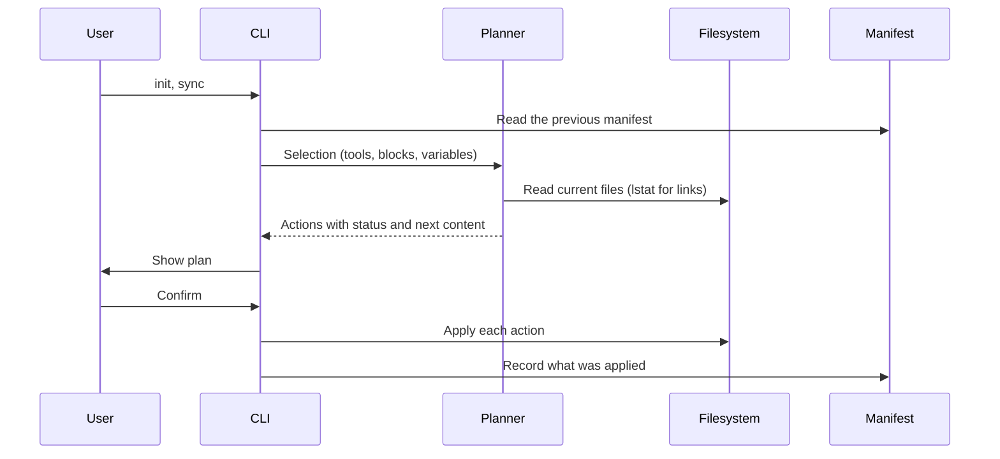

# Architecture

## Flow

Every command that writes builds a plan first. Interactive runs show the plan and ask before applying. Without a terminal, the CLI prints the plan and applies it only with `--yes`. `--dry-run` prints it and exits.

## Blocks

`blocks/index.yaml` lists every block in composition order, together with the group labels and the header for the system-wide file. The loader rejects:

- files missing from the order
- unknown groups, or a group that does not match the block's directory
- defaults outside a block's scopes
- placeholders that are not declared as variables, and declared variables that are never used
- `requires` entries that name an unknown block, a block later in the order, or a block missing one of the scopes

Selecting a block also selects the blocks it requires. Blocks recorded in a manifest that are no longer in the library are dropped with a warning.

The system-wide file is the global header plus the selected blocks joined by blank lines. A project file gets the selected blocks inside a managed region, below a `# <project name>` heading that is written once.

## Plans and actions

Each target becomes one action:

| Status      | Meaning                                                    |
| ----------- | ---------------------------------------------------------- |
| `create`    | The file or link does not exist yet                        |
| `update`    | The managed content differs from what is on disk           |
| `unchanged` | Nothing to do                                              |
| `remove`    | The entry is in the manifest but no longer selected        |
| `conflict`  | The file cannot be changed safely, so it is left untouched |

Conflicts come from malformed markers, JSON files with comments or invalid syntax, and unmanaged files at a path the CLI wants to own (for example `~/.local/bin/agents-config`).

## Writers

- **Managed region.** Text between `<!-- BEGIN:agents-config -->` and `<!-- END:agents-config -->`. A file without markers gets the region appended after its content. Duplicate or unmatched markers are a conflict. CRLF files keep their line endings.
- **Import line.** A single line such as `@AGENTS.md`, prepended to an existing `CLAUDE.md`. A `CLAUDE.md` that is a link to `AGENTS.md` needs no import line and is left alone.
- **JSON array values.** Adds values to a key such as `context.fileName` and removes only the values the CLI added. A string value is converted to a list and restored on removal. Files with comments are refused.
- **Exclude region.** `# BEGIN:agents-config <dir>` markers in the repository's `info/exclude`, one region per project, with patterns relative to the repository root.
- **Symlink.** Replaced only when the manifest owns it and it still points where the CLI left it. A link someone retargeted is left alone.

A target that is itself a symlink, such as a `CLAUDE.md` linked from a dotfiles repository, is written through: the CLI edits the file the link points to and keeps the link.

Writes are atomic: content goes to a temporary file, which is then renamed over the target. The file keeps its permissions.

## Manifests

| Scope       | File                                    | Paths                            |
| ----------- | --------------------------------------- | -------------------------------- |
| System-wide | `~/.agents/agents-config/manifest.json` | Absolute                         |
| Project     | `<project>/.agents/agents-config.json`  | Relative, so it can be committed |

A manifest stores the selection (tools, blocks, variables, options) and one entry per owned path. After an apply, the manifest records every action that actually ran, so if an action fails, the files already written stay tracked. A project manifest is rejected when an entry points outside the project, or when its exclude entry belongs to another repository.

## Ownership rules

- Only paths recorded in a manifest are ever modified or deleted.
- A file the CLI created is deleted when its managed content is removed and nothing else is left, including the project heading it wrote. A file that existed before keeps its other content.
- A file shared by several tools, such as `~/.gemini/AGENTS.md`, stays until no selected tool uses it.
- Directories the CLI created are left in place.

## Exit codes

| Code | Meaning                                                                                       |
| ---- | --------------------------------------------------------------------------------------------- |
| 0    | Success                                                                                       |
| 1    | Conflicts were skipped, `doctor` found errors, the run was cancelled, or `--yes` was required |
| 2    | Usage error                                                                                   |
