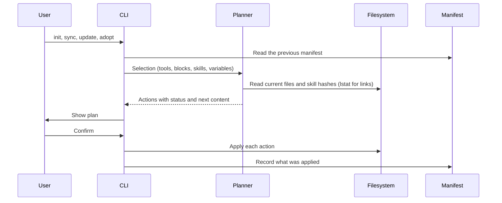

# Architecture

## Flow

Every command that writes builds a plan first. Interactive runs show the plan and ask before applying. Without a terminal, the CLI prints the plan and applies it only with `--yes`. `--dry-run` prints it and exits.

## Blocks

`blocks/index.yaml` lists every block in composition order, together with the group labels and the header for the system-wide file. The loader rejects:

- files missing from the order
- unknown groups, or a group that does not match the block's directory
- defaults outside a block's scopes
- placeholders that are not declared as variables, and declared variables that are never used
- `requires` entries that name an unknown block, a block later in the order, or a block missing one of the scopes

Selecting a block also selects the blocks it requires. Blocks recorded in a manifest that are no longer in the library are dropped with a warning.

The system-wide file is the global header plus the selected blocks joined by blank lines. A project file gets the selected blocks inside a managed region, below a project seed preamble (`# <project name>`, optional description, `## Commands` and `## Workspaces`) that is written once when creating the file and preserved outside `<!-- BEGIN:agents-config -->` across `sync` and `update`.

## Project stack presets, detection and seed generation (`src/project/`)

`presets/<id>.yaml` defines the seven built-in project stack presets (`nextjs-app`, `nestjs-api`, `nx-monorepo`, `expo-app`, `vite-spa`, `python-service`, `node-tool`), validated with `zod` against the repository's `BlockLibrary` and `SkillLibrary` (`src/project/presets.ts`).

When initializing a project (`agents-config init --project <dir>`), `detectProject` (`src/project/detect.ts`) inspects regular files inside the project boundary (`package.json`, `nx.json`, `pyproject.toml`, `.nvmrc`, `prisma/schema.prisma`, `prisma.config.ts`, `supabase/config.toml`, `components.json`, lockfiles and workspace packages under `apps/*`, `packages/*`, `libs/*`) to:

1. Select a matching preset (or union workspace sub-app/lib stacks for `nx-monorepo`) and additive blocks/skills (`stack/prisma` + `prisma-*`, `stack/supabase-prisma` + `supabase-prisma`/`supabase`/`supabase-postgres-best-practices`, `stack/tanstack-query` + `tanstack-query-expert`, `stack/tailwind-shadcn` + `tailwind-patterns`, `stack/llm-apps` + `ai-sdk`/`claude-api`, `playwright-cli`).
2. Resolve the block selection in either `lean` style (default when a system-wide install exists: only `stack/*` blocks, assuming global `AGENTS.md` is installed) or `self-contained` style (default when no system-wide install exists: project-default core, engineering and git blocks plus `stack/*` blocks).
3. Synthesize the initial project seed preamble (`src/project/seed.ts`) with `# <name>`, description, `## Commands` and `## Workspaces` (falling back to `# <name>` when no scripts or workspaces exist).

## Skills and the source cache

Skills come from two places:

- `skills/<name>/`: first-party skills in this repository, validated strictly against the Agent Skills specification.
- `catalog.yaml`: curated third-party skills referenced by `repo` (`owner/repo`), `path` (`.` for the repository root or a subdirectory), optional `ref` (branch, tag or 40-char commit SHA), `category`, `scopes`, `defaults`, optional `setup` command and optional `note`.

Upstream repositories are cached under `${XDG_CACHE_HOME:-~/.cache}/agents-config/sources/<owner>/<repo>` as depth-1, blob-filtered (`--filter=blob:none`), sparse checkouts limited to the paths listed in `catalog.yaml`. Update checks run `git ls-remote` at most once every 24 hours per repository unless forced by `agents-config update`.

When a skill is installed as a copy, the tree walker leaves out `.git`, `.github`, `node_modules`, `.DS_Store`, root `evals/`, and any nested `AGENTS.md`, `CLAUDE.md` or `GEMINI.md`, then hashes every file path, mode and SHA-256 digest. In system-wide `link` mode, first-party skills are symlinked directly to `skills/<name>` while third-party skills remain copies.

`agents-config update` diffs each installed skill copy against the freshly fetched source and scans added or modified files for risky patterns (`curl`/`wget` piped to a shell, `npx -y`/`--yes`, unpinned `@latest` packages, `rm -rf`, base64 decoded into a shell, new executable files, hooks and `allowed-tools` changes) before asking for confirmation.

## Skill evaluation (`src/evals/`)

First-party skills under `skills/<name>/` can include an `evals/` directory (excluded when copying skills into `~/.agents/skills`):

- `evals/evals.json`: validated with `zod` (`src/evals/cases.ts`). Defines test cases with `id`, `prompt`, `expected_output`, optional input `files` under `evals/files/`, and `assertions` (either natural-language strings graded by a blind LLM grader or deterministic scripted checks: `file_exists`, `file_absent`, `regex`, `json_valid`, `command`).
- `evals/trigger_queries.json`: validated with `zod`. Defines positive (`should_trigger: true`) and near-miss negative (`should_trigger: false`) user prompts partitioned into a deterministic 60/40 stratified `train`/`validation` split seeded by query text SHA-256.

### Evaluation pipeline

`agents-config skill eval <name>` runs a four-stage pipeline (`src/evals/engine.ts`):

1. **Workspace preparation (`src/evals/workspace.ts`):** For each `(case, variant, run)` job, creates `<runDir>/workdir`, copies fixture files (stripping leading `evals/files/` and `<case-id>/` segments), initializes a git repository with `.agents/`, `.claude/`, `.gemini/` and `.codex/` in `.git/info/exclude`, and commits the initial fixture files so `git status` starts clean. For `with_skill`, copies the skill into `<workdir>/.agents/skills/<name>`. For `old_skill` (`--compare <ref>` or `--baseline <ref>`), extracts the historical skill snapshot via `git ls-tree` and `git show` without mutating the working tree.
2. **Runner execution (`src/evals/runners/`):** Auto-detects the default runner on `PATH` using `which` (`agy` -> `claude` -> `codex` -> `gemini`) or uses `--runner`. Spawns the runner in headless stream-JSON mode, logs raw `stdout.log` and `stderr.log`, and requires a final result event (`type: "result"` or `type: "turn.completed"`) before extracting the response, duration, token usage, and skill trigger signals.
3. **Two-phase grading (`src/evals/grade.ts`):** Evaluates deterministic scripted assertions (`file_exists`, `file_absent`, `regex`, `json_valid`, `command`) first, then captures the workspace file summary and invokes the blind LLM grader (`runner.runGrader`) with structured JSON schema output for natural-language string assertions. The grader prompt never reveals the variant name, and any string assertion without non-empty supporting `evidence` is forced to `passed: false`.
4. **Aggregation and reporting (`src/evals/aggregate.ts`, `src/evals/report.ts`):** Computes mean, sample stddev, min, and max for pass rate, duration, and token count; classifies each assertion (`differentiating`, `non-discriminating`, `regressing`, `failing`, `flaky`); populates `assertion_analysis` (`pass_only_with_skill`, `pass_in_both`, `fail_in_both`, `flaky`); and writes `benchmark.json` and `report.md` under `~/.agents/agents-config/evals/<name>/iteration-<N>/`.

### Baseline skill exclusion and contamination detection

`without_skill` baseline runs never modify or delete global skills in `~/.agents/skills`:

| Runner   | Workspace / CLI baseline exclusion                                                                                 | Contamination check                                                                                                 |
| -------- | ------------------------------------------------------------------------------------------------------------------ | ------------------------------------------------------------------------------------------------------------------- |
| `agy`    | Writes `<workdir>/.agents/skills.json` with `{ "exclude": ["<name>"] }`                                            | Clean (`possiblyContaminated: false`)                                                                               |
| `claude` | Writes `<workdir>/.claude/settings.local.json` (`skillOverrides` + `permissions.deny`) and `--disallowedTools` CLI | Clean (`possiblyContaminated: false`)                                                                               |
| `gemini` | Writes `<workdir>/.gemini/settings.json` with `{ "skills": { "disabled": ["<name>"] } }`                           | Clean (`possiblyContaminated: false`)                                                                               |
| `codex`  | No workspace-level skill exclusion setting available                                                               | Checks all global skill roots and `scanInstalledSkills`; marks baseline `"possibly contaminated"` if skill is found |
| `fake`   | Writes `<workdir>/.agents/skills.json` with `{ "exclude": ["<name>"] }`                                            | Clean (`possiblyContaminated: false`)                                                                               |

## Plans and actions

Each target becomes one action:

| Status      | Meaning                                                                     |
| ----------- | --------------------------------------------------------------------------- |
| `create`    | The file, skill tree or link does not exist yet                             |
| `update`    | The managed content or skill tree differs from what is on disk              |
| `unchanged` | Nothing to do, including when the CLI stops tracking a path it never edited |
| `remove`    | Content or a skill the CLI added is removed because it is no longer chosen  |
| `conflict`  | The path cannot be changed safely, so it is left untouched                  |

Conflicts come from malformed markers, JSON files with comments or invalid syntax, unmanaged files or skill directories at a path the CLI wants to own, installed skill copies whose content hash no longer matches the manifest, paths that are directories, special files or unreadable, links to missing locations, and project files whose real location is outside the project.

`agents-config adopt` resolves conflicts on unmanaged skill directories by moving the existing folder and tool links into `~/.agents/agents-config/backups/<timestamp>/` before installing the managed copy and links. If an unmanaged skill is tracked in `~/.agents/.skill-lock.json` with a GitHub upstream, `adopt` also adds it to `catalog.yaml`.

## Writers

- **Managed region.** Text between `<!-- BEGIN:agents-config -->` and `<!-- END:agents-config -->`. A file without markers gets the region appended after its content. Duplicate or unmatched markers are a conflict. Lines outside the region keep their own line endings, and new lines use the ending most of the file uses.
- **Import line.** A single line such as `@AGENTS.md`, prepended to an existing `CLAUDE.md`. A `CLAUDE.md` that is a link to `AGENTS.md` needs no import line and is left alone, even before `AGENTS.md` exists.
- **JSON array values.** Adds values to a key such as `context.fileName` and removes only the values the CLI added. A string value is converted to a list and restored on removal. Files with comments are refused.
- **Exclude region.** `# BEGIN:agents-config <dir>` markers in the repository's `info/exclude`, one region per project, with patterns relative to the repository root (including project skill directories and links). When a project kept local is no longer in a git repository, the option is dropped with a notice.
- **Symlink.** Replaced only when the manifest owns it and it still points where the CLI left it. A link someone retargeted is left alone.
- **Skill tree.** Staged in a sibling temporary directory and swapped into place atomically, keeping any backup of an adopted directory. Optional `setup` commands run inside the installed directory after copying; a setup failure is reported without aborting the rest of the install.

A target that is itself a symlink, such as a `CLAUDE.md` linked from a dotfiles repository, is written through: the CLI edits the file the link points to and keeps the link. In a project, this only happens when the real location, with every link resolved, is inside the project. A committed link or linked directory that leads elsewhere is a conflict, so a repository cannot point the CLI at files such as `~/.zshrc` or a skill directory outside the project. The git exclude file is the one exception, because git itself reports where it is.

Writes are atomic: content goes to a temporary file, which is then renamed over the target. The file keeps its permissions.

## Manifests and the projects registry

| Scope             | File                                    | Paths                            |
| ----------------- | --------------------------------------- | -------------------------------- |
| System-wide       | `~/.agents/agents-config/manifest.json` | Absolute                         |
| Project           | `<project>/.agents/agents-config.json`  | Relative, so it can be committed |
| Projects registry | `~/.agents/agents-config/projects.json` | Absolute project directories     |

A manifest stores the selection (tools, blocks, skills, variables, options) and one entry per owned path. Skill entries record provenance (`catalog` with repo, path, optional ref and commit SHA, or `local` with path) and the install record (`copy` with tree SHA-256 hash, or `link` with target). After an apply, the manifest records every action that actually ran, so if an action fails, the files already written stay tracked.

Applying a project install records the project directory in `~/.agents/agents-config/projects.json`; removing a project install removes its entry from the registry. `agents-config update` uses this registry to refresh every recorded project alongside the system-wide install, skipping and dropping any project whose manifest was deleted.

## Ownership rules

- Only paths recorded in a manifest are ever modified or deleted.
- A file the CLI created is deleted when its managed content is removed and nothing else is left, including the project heading it wrote. A file that existed before keeps its other content.
- A skill copy whose content hash differs from the manifest is left in place on update, sync or removal.
- A file shared by several tools, such as `~/.gemini/AGENTS.md` or `~/.agents/skills/<name>`, stays until no selected tool uses it.
- Directories the CLI created are left in place.

## Exit codes

| Code | Meaning                                                                                    |
| ---- | ------------------------------------------------------------------------------------------ |
| 0    | Success                                                                                    |
| 1    | Conflicts or setup failures occurred, `doctor`/`skill validate` found errors, or cancelled |
| 2    | Usage error                                                                                |
