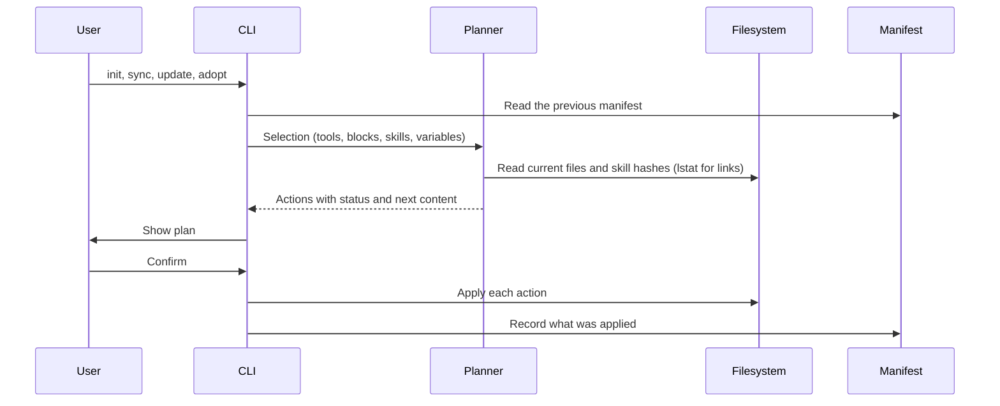

# Architecture

## Flow

Every command that writes builds a plan first. Interactive runs show the plan and ask before applying. Without a terminal, the CLI prints the plan and applies it only with `--yes`. `--dry-run` prints it and exits.

## Blocks

`blocks/index.yaml` lists every block in composition order, together with the group labels and the header for the system-wide file. The loader rejects:

- files missing from the order
- unknown groups, or a group that does not match the block's directory
- defaults outside a block's scopes
- placeholders that are not declared as variables, and declared variables that are never used
- `requires` entries that name an unknown block, a block later in the order, or a block missing one of the scopes

Selecting a block also selects the blocks it requires. Blocks recorded in a manifest that are no longer in the library are dropped with a warning.

The system-wide file is the global header plus the selected blocks joined by blank lines. A project file gets the selected blocks inside a managed region, below a `# <project name>` heading that is written once.

## Skills and the source cache

Skills come from two places:

- `skills/<name>/`: first-party skills in this repository, validated strictly against the Agent Skills specification.
- `catalog.yaml`: curated third-party skills referenced by `repo` (`owner/repo`), `path` (`.` for the repository root or a subdirectory), optional `ref` (branch, tag or 40-char commit SHA), `category`, `scopes`, `defaults`, optional `setup` command and optional `note`.

Upstream repositories are cached under `${XDG_CACHE_HOME:-~/.cache}/agents-config/sources/<owner>/<repo>` as depth-1, blob-filtered (`--filter=blob:none`), sparse checkouts limited to the paths listed in `catalog.yaml`. Update checks run `git ls-remote` at most once every 24 hours per repository unless forced by `agents-config update`.

When a skill is installed as a copy, the tree walker leaves out `.git`, `.github`, `node_modules`, `.venv`, generated output (`.DS_Store`, `__pycache__`, `*.pyc`, `.pytest_cache`), root `evals/`, and any nested `AGENTS.md`, `CLAUDE.md` or `GEMINI.md`. The manifest records a hash of what is copied: each file's path, whether it is a file or a link, its executable bit and the SHA-256 digest of its content (the target for a link).

Links inside a skill are copied as links only when they are relative and resolve, from the link's own directory, inside the skill folder. An absolute link or one that leaves the folder, such as `/etc/hosts` or `../../shared`, is a validation error, so the skill is skipped with a problem message, and the copy step refuses it as well.

To decide whether an installed copy is still the one the CLI wrote, the CLI hashes the installed folder the same way but without the copy exclusions: every path counts except generated output, plus `node_modules` and `.venv` when the install record says the skill has a `setup` command. A pristine copy matches the recorded hash, running the skill's scripts or its setup does not change it, and any file someone added, including an `evals/` folder or a nested `AGENTS.md`, makes the copy count as changed outside the CLI.

In system-wide `link` mode, first-party skills are symlinked directly to `skills/<name>` while third-party skills remain copies.

`agents-config update` diffs each installed skill copy against the freshly fetched source and scans added or modified files for risky patterns (`curl`/`wget` piped to a shell, downloads run through `bash <(curl …)`, `sh -c "$(wget …)"` or `eval "$(curl …)"`, `npx -y`/`--yes`, unpinned `@latest` packages, `rm -rf` including split flags such as `rm -r -f`, base64 decoded into a shell, new executable files, new or retargeted links, hooks and `allowed-tools` changes, whether written as a string or a list) before asking for confirmation.

## Plans and actions

Each target becomes one action:

| Status      | Meaning                                                                     |
| ----------- | --------------------------------------------------------------------------- |
| `create`    | The file, skill tree or link does not exist yet                             |
| `update`    | The managed content or skill tree differs from what is on disk              |
| `unchanged` | Nothing to do, including when the CLI stops tracking a path it never edited |
| `remove`    | Content or a skill the CLI added is removed because it is no longer chosen  |
| `conflict`  | The path cannot be changed safely, so it is left untouched                  |

Conflicts come from malformed markers, JSON files with comments or invalid syntax, unmanaged files or skill directories at a path the CLI wants to own, installed skill copies whose content hash no longer matches the manifest, paths that are directories, special files or unreadable, links to missing locations, and project files whose real location is outside the project.

`agents-config adopt` resolves conflicts on unmanaged skill directories by moving the existing folder and tool links into `~/.agents/agents-config/backups/<timestamp>/` before installing the managed copy and links. It needs an existing system-wide install (`agents-config init --global`) and refuses a skill when any of its locations, or the folder a link resolves to, is named differently from the skill's declared `name`, so no duplicate is left behind. If an unmanaged skill is tracked in `~/.agents/.skill-lock.json` with a GitHub upstream, `adopt` also adds it to `catalog.yaml`: the entry is checked against the catalog rules before anything changes, appended to the end of the file without reformatting it, and written just before the plan is applied. If `catalog.yaml` cannot be written, nothing is applied, and if applying fails, the original `catalog.yaml` is put back, so the catalog and the manifest stay consistent.

## Writers

- **Managed region.** Text between `<!-- BEGIN:agents-config -->` and `<!-- END:agents-config -->`. A file without markers gets the region appended after its content. Duplicate or unmatched markers are a conflict. Lines outside the region keep their own line endings, and new lines use the ending most of the file uses.
- **Import line.** A single line such as `@AGENTS.md`, prepended to an existing `CLAUDE.md`. A `CLAUDE.md` that is a link to `AGENTS.md` needs no import line and is left alone, even before `AGENTS.md` exists.
- **JSON array values.** Adds values to a key such as `context.fileName` and removes only the values the CLI added. A string value is converted to a list and restored on removal. Files with comments are refused.
- **Exclude region.** `# BEGIN:agents-config <dir>` markers in the repository's `info/exclude`, one region per project, with patterns relative to the repository root (including project skill directories and links). When a project kept local is no longer in a git repository, the option is dropped with a notice.
- **Symlink.** Replaced only when the manifest owns it and it still points where the CLI left it. A link someone retargeted is left alone.
- **Skill tree.** Staged in a sibling temporary directory and swapped into place atomically, keeping any backup of an adopted directory. Optional `setup` commands run inside the installed directory after copying; a setup failure is reported without aborting the rest of the install.

A target that is itself a symlink, such as a `CLAUDE.md` linked from a dotfiles repository, is written through: the CLI edits the file the link points to and keeps the link. In a project, this only happens when the real location, with every link resolved, is inside the project. A committed link or linked directory that leads elsewhere is a conflict, so a repository cannot point the CLI at files such as `~/.zshrc` or a skill directory outside the project. The git exclude file is the one exception, because git itself reports where it is.

Writes are atomic: content goes to a temporary file, which is then renamed over the target. The file keeps its permissions.

## Manifests and the projects registry

| Scope             | File                                    | Paths                            |
| ----------------- | --------------------------------------- | -------------------------------- |
| System-wide       | `~/.agents/agents-config/manifest.json` | Absolute                         |
| Project           | `<project>/.agents/agents-config.json`  | Relative, so it can be committed |
| Projects registry | `~/.agents/agents-config/projects.json` | Absolute project directories     |

A manifest stores the selection (tools, blocks, skills, variables, options) and one entry per owned path. Skill entries record provenance (`catalog` with repo, path, optional ref and commit SHA, or `local` with path) and the install record (`copy` with tree SHA-256 hash and `setup: true` when the skill has a setup command, or `link` with target). After an apply, the manifest records every action that actually ran, so if an action fails, the files already written stay tracked.

When a manifest is read, every skill entry must be `<skills folder>/<name>` (`~/.agents/skills/<name>` system-wide, `.agents/skills/<name>` in a project), and every skill link must be a link named after a skill directly inside a tool's skills folder (in a project, every recorded link must be such a skill link). Otherwise the manifest is refused before anything is reported or planned; `agents-config update` skips such a project with a warning.

Applying a project install records the project directory in `~/.agents/agents-config/projects.json`; removing a project install removes its entry from the registry. `agents-config update` uses this registry to refresh every recorded project alongside the system-wide install. A project whose manifest was deleted is skipped and forgotten only once the update is applied, never on a dry run, a declined confirmation or a run without `--yes`. A project whose manifest cannot be read or is refused, and a corrupt registry, are skipped with a warning while everything else is still updated.

## Ownership rules

- Only paths recorded in a manifest are ever modified or deleted.
- A file the CLI created is deleted when its managed content is removed and nothing else is left, including the project heading it wrote. A file that existed before keeps its other content.
- A skill copy whose content hash differs from the manifest is left in place on update, sync or removal.
- A file shared by several tools, such as `~/.gemini/AGENTS.md` or `~/.agents/skills/<name>`, stays until no selected tool uses it.
- Directories the CLI created are left in place.

## Exit codes

| Code | Meaning                                                                                    |
| ---- | ------------------------------------------------------------------------------------------ |
| 0    | Success                                                                                    |
| 1    | Conflicts or setup failures occurred, `doctor`/`skill validate` found errors, or cancelled |
| 2    | Usage error                                                                                |
